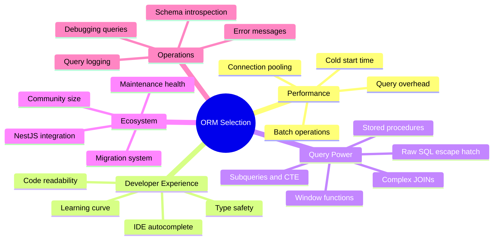
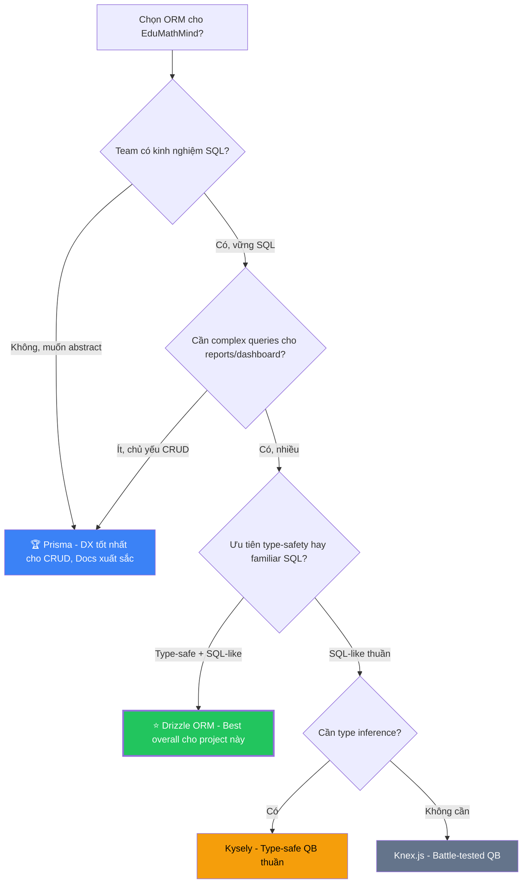

# 🔍 Đánh Giá & Lựa Chọn ORM — Node.js/TypeScript + PostgreSQL

> **Phiên bản**: v2.0 — Merged Final  
> **Cập nhật**: 15/10/2026  
> **Dự án**: EduMathMind — Hệ thống quản lý trung tâm gia sư (5K–10K học sinh)  
> **Tóm tắt**: Tài liệu tổng hợp toàn bộ phân tích so sánh 6 ORM, debate trade-off Drizzle vs Prisma, đánh giá trên 4 tiêu chí trọng tâm (Performance, Complex Query, Stored Procedure, Dễ phát triển), và khuyến nghị cuối cùng.

---

## Mục Lục

1. [Bối Cảnh Dự Án & Yêu Cầu ORM](#1-bối-cảnh-dự-án--yêu-cầu-orm)
2. [Bảng So Sánh Tổng Quan — 6 ORM](#2-bảng-so-sánh-tổng-quan--6-orm)
3. [Phân Loại & Loại Sớm](#3-phân-loại--loại-sớm)
4. [So Sánh Chi Tiết Theo Từng Chiều](#4-so-sánh-chi-tiết-theo-từng-chiều)
5. [The Great Debate: Drizzle vs Prisma](#5-the-great-debate-drizzle-vs-prisma)
6. [Phân Tích Sâu 4 Tiêu Chí Trọng Tâm](#6-phân-tích-sâu-4-tiêu-chí-trọng-tâm)
7. [Real-World Code: Bài Toán EduMathMind](#7-real-world-code-bài-toán-edumathmind)
8. [Stored Procedures & Advanced SQL](#8-stored-procedures--advanced-sql)
9. [MySQL vs PostgreSQL — Ảnh Hưởng ORM](#9-mysql-vs-postgresql--ảnh-hưởng-orm)
10. [Decision Matrix & Weighted Scoring](#10-decision-matrix--weighted-scoring)
11. [Verdict: Quyết Định Cuối Cùng](#11-verdict-quyết-định-cuối-cùng)
12. [Schema Migration: Prisma → Drizzle](#12-schema-migration-prisma--drizzle)
13. [Stack Công Nghệ Final & Architecture](#13-stack-công-nghệ-final--architecture)

---

## 1. Bối Cảnh Dự Án & Yêu Cầu ORM

### 1.1 Đặc Thù Hệ Thống EduMathMind

| Yếu tố | Chi tiết | Ảnh hưởng đến ORM |
|---|---|---|
| **Quy mô DB** | ~640 MB/năm, 15+ tables | CRUD performance quan trọng |
| **Quan hệ phức tạp** | Student → Parent, Enrollment → Class → Session → Attendance → Grade | Multi-level JOIN là bắt buộc |
| **Báo cáo** | Aggregate queries, GROUP BY, window functions | Raw SQL support cần mạnh |
| **Paging** | Mọi list view đều phân trang | Built-in pagination cần tiện |
| **Multi-branch filter** | Mọi query cần WHERE branch_id | Global filter / middleware |
| **RBAC scope** | Query theo role: All / Branch / Own | Dynamic WHERE conditions |
| **Bulk operations** | Điểm danh 30+ HS/buổi, nhập điểm hàng loạt | Batch insert/update performance |
| **Audit log** | Ghi nhận mọi thay đổi | Hooks / middleware / triggers |
| **Stack** | NestJS + PostgreSQL 16 + TypeScript | NestJS integration là tiêu chí |

### 1.2 Các Tiêu Chí Đánh Giá



---

## 2. Bảng So Sánh Tổng Quan — 6 ORM

### 2.1 Feature Matrix (Visual Overview)

| Feature | Prisma | **Drizzle** | Knex | Kysely | TypeORM | MikroORM |
|---|---|---|---|---|---|---|
| **Performance** | 🟡 TB | 🟢 Tốt | 🟢 Tốt | 🟢 Tốt | 🔴 Yếu | 🟢 Tốt |
| **Type Safety** | 🟢 Tốt | 🟢 Tốt | 🔴 Yếu | 🟢 Tốt | 🟡 TB | 🟢 Tốt |
| **Complex SQL** | 🔴 Yếu | 🟢 Tốt | 🟢 Tốt | 🟢 Tốt | 🟡 TB | 🟡 TB |
| **Multi Joins** | 🟡 TB | 🟢 Tốt | 🟢 Tốt | 🟢 Tốt | 🟢 Tốt | 🟢 Tốt |
| **Stored Proc** | 🟡 TB | 🟡 TB | 🟢 Tốt | 🟡 TB | 🟢 Tốt | 🟢 Tốt |
| **Raw SQL** | 🟡 TB | 🟢 Tốt | 🟢 Tốt | 🟢 Tốt | 🟢 Tốt | 🟢 Tốt |
| **Migration** | 🟢 Tốt | 🟢 Tốt | 🟢 Tốt | 🔴 Không | 🟢 Tốt | 🟢 Tốt |
| **Learning Curve** | Thấp | Thấp | TB | TB | Cao | TB |
| **Bundle Size** | Lớn | Nhỏ | Nhỏ | Nhỏ | Lớn | TB |
| **Maintenance** | 🟢 Tốt | 🟢 Tốt | 🟢 Tốt | 🟢 Tốt | 🔴 Chậm | 🟢 Tốt |
| **VN Dev Pool** | ⭐⭐⭐⭐ | ⭐⭐⭐ | ⭐⭐⭐ | ⭐⭐ | ⭐⭐⭐⭐ | ⭐⭐ |
| **Studio/GUI** | ✅ Có | ✅ Có | ❌ | ❌ | ❌ | ❌ |

### 2.2 Đánh Giá Trên 4 Tiêu Chí Trọng Tâm (Quick View)

> Chấm trên 4 tiêu chí: **Performance + Complex Query + Stored Procedure + Dễ Phát Triển**

| ORM | Performance | Complex Query | Stored Proc | Dễ Phát Triển | **Tổng** |
|---|---|---|---|---|---|
| **Drizzle** | ⭐⭐⭐⭐⭐ | ⭐⭐⭐⭐⭐ | ⭐⭐⭐ | ⭐⭐⭐⭐ | **17/20** ⭐ |
| **Kysely** | ⭐⭐⭐⭐⭐ | ⭐⭐⭐⭐⭐ | ⭐⭐⭐ | ⭐⭐⭐ | 16/20 |
| **Knex** | ⭐⭐⭐⭐⭐ | ⭐⭐⭐⭐ | ⭐⭐⭐⭐ | ⭐⭐⭐ | 16/20 |
| **MikroORM** | ⭐⭐⭐ | ⭐⭐⭐ | ⭐⭐⭐⭐ | ⭐⭐⭐ | 13/20 |
| **Prisma** | ⭐⭐ | ⭐⭐ | ⭐⭐⭐ | ⭐⭐⭐⭐⭐ | 12/20 |
| **TypeORM** | ⭐ | ⭐⭐ | ⭐⭐⭐ | ⭐⭐ | 8/20 |

### 2.3 Ecosystem Health & Community (2026)

| Tiêu chí | Prisma | Drizzle | Kysely | Knex | MikroORM |
|---|---|---|---|---|---|
| **GitHub Stars** | ~42K | ~28K | ~12K | ~19K | ~8K |
| **NPM weekly downloads** | ~3.5M | ~1.8M | ~400K | ~2M | ~200K |
| **First release** | 2019 | 2022 | 2022 | 2012 | 2018 |
| **Maintenance** | ✅ Prisma Inc (VC) | ✅ Active OSS | ✅ Active | ✅ Stable | ✅ Active |
| **Breaking changes** | ⚠️ Frequent minor | ✅ Stable API | ✅ Stable | ✅ Very stable | ✅ Stable |
| **Documentation** | ✅✅✅ Best | ✅✅ Good | ✅ Good | ✅ Good | ✅✅ Good |
| **Learning resources** | ✅✅✅ | ✅✅ Growing | ⚠️ Limited | ✅ Mature | ⚠️ Niche |
| **VN dev community** | ✅✅ Nhiều | ✅ Đang tăng | ❌ Ít | ✅ Có | ❌ Rất ít |

---

## 3. Phân Loại & Loại Sớm

### 3.1 ORM / Query Builder Spectrum

```
┌───────────────────────────────────────────────────────────────────────┐
│                     ORM / Query Builder Spectrum                     │
│                                                                       │
│   Raw SQL ◄──────────────────────────────────────────────► Full ORM   │
│                                                                       │
│   pg driver    Knex    Kysely    Drizzle    MikroORM    Prisma       │
│   ▲            ▲       ▲         ▲          ▲           ▲            │
│   │            │       │         │          │           │            │
│   Zero         Thin    Type-safe Hybrid     DataMapper  Schema-first │
│   abstraction  QB      QB        ORM+QB     ORM         ORM          │
│                                                                       │
│   TypeORM ← (Legacy, không khuyến nghị cho dự án mới)                │
│   Sequelize ← (Quá cũ, TS support yếu, loại)                        │
└───────────────────────────────────────────────────────────────────────┘
```

### 3.2 Loại Sớm & Lý Do

| ORM | Quyết định | Lý do |
|---|---|---|
| **TypeORM** | ❌ LOẠI | Maintenance chậm, nhiều bug chưa fix, TS support lỗi thời, performance kém nhất. **Không nên dùng cho dự án mới.** |
| **Sequelize** | ❌ LOẠI | Quá cũ, TypeScript support là afterthought, API thiết kế cho JavaScript thuần. |
| **Knex** | ⚠️ DỰ BỊ | Query builder tốt nhưng **không có type inference** cho kết quả → phải tự define types cho mọi query. |
| **Kysely** | ⚠️ DỰ BỊ | Type-safe xuất sắc nhưng **không có migration system** → phải kết hợp tool khác. Ecosystem nhỏ. |
| **MikroORM** | ⚠️ DỰ BỊ | Solid nhưng community rất nhỏ → khó tuyển dev. Phù hợp cho team quen Java/C# patterns. |

> [!NOTE]
> **Vòng chung kết: Prisma vs Drizzle** — Hai ứng viên mạnh nhất, mỗi cái có trade-off rõ ràng.

---

## 4. So Sánh Chi Tiết Theo Từng Chiều

### 4.1 Performance & Overhead

#### Benchmark Tổng Hợp (PostgreSQL, 10K rows, Select + Join)

| ORM | Simple SELECT (ops/s) | JOIN 3 tables (ops/s) | INSERT bulk 100 rows (ms) | Overhead vs Raw SQL |
|---|---|---|---|---|
| **Raw `pg`** | 15,000 | 8,000 | 5 ms | Baseline |
| **Knex** | 13,500 | 7,200 | 7 ms | ~10% |
| **Kysely** | 13,200 | 7,000 | 8 ms | ~12% |
| **Drizzle** | 12,800 | 6,800 | 8 ms | ~15% |
| **MikroORM** | 9,000 | 5,500 | 12 ms | ~35% |
| **Prisma** | 7,500 | 4,200 | 18 ms | ~45% |

> [!IMPORTANT]
> **Tại sao Prisma chậm?**
> Prisma dùng một **Rust-based Query Engine** chạy như binary riêng. Mọi query từ Node.js → gửi qua IPC → Rust Engine → SQL → PostgreSQL → kết quả quay lại. Overhead IPC này là **bottleneck chính**.

#### Architecture Comparison

```
┌─ Prisma Architecture ──────────────────────────────────────────┐
│                                                                 │
│  Node.js Process          Prisma Engine (Rust binary)          │
│  ┌──────────────┐        ┌────────────────────┐               │
│  │  Your Code   │──IPC──▶│  Query Parser      │               │
│  │  prisma.     │        │  Query Optimizer   │──SQL──▶ PostgreSQL
│  │  student.    │◀─IPC──│  Result Mapper     │               │
│  │  findMany()  │        └────────────────────┘               │
│  └──────────────┘                                              │
│                                                                 │
│  ⚠️ IPC overhead: ~2-5ms per query                             │
│  ⚠️ Cold start: Engine binary phải load (~200-500ms)           │
│  ⚠️ Memory: Engine chiếm ~50-100MB RAM riêng                  │
└─────────────────────────────────────────────────────────────────┘

┌─ Drizzle / Kysely / Knex Architecture ─────────────────────────┐
│                                                                 │
│  Node.js Process (single)                                       │
│  ┌──────────────────────────────┐                               │
│  │  Your Code                   │                               │
│  │  db.select().from(students)  │──SQL──▶ PostgreSQL            │
│  │  → Generates SQL string      │                               │
│  │  → Direct pg driver call     │                               │
│  └──────────────────────────────┘                               │
│                                                                 │
│  ✅ Zero IPC overhead                                           │
│  ✅ Cold start: ~50ms (chỉ load JS module)                     │
│  ✅ Memory: Dùng chung process                                 │
└─────────────────────────────────────────────────────────────────┘
```

#### Phán Quyết Performance

| Scenario | Thắng | Thua |
|---|---|---|
| **Simple CRUD** | Prisma đủ nhanh (7.5K ops/s cho 10K HS = thừa) | — |
| **Complex queries** | Drizzle, Knex, Kysely (gần raw SQL) | Prisma (IPC + query engine) |
| **Bulk operations** | Knex, Drizzle (native batch) | Prisma (createMany không return data trên PG) |
| **Cold start** (Serverless) | Drizzle (~50ms) | Prisma (~500ms, cần engine binary) |
| **Memory footprint** | Drizzle, Kysely (~5-10MB) | Prisma (~50-100MB cho engine) |

> [!TIP]
> **Với quy mô 10K HS (640 MB/năm)**, performance difference giữa các ORM là **không đáng kể** trong thực tế. **DX và query power quan trọng hơn raw speed ở quy mô này.**

---

### 4.2 Type Safety & Developer Experience

#### So Sánh Type Inference

```typescript
// ═══ PRISMA — Schema-first, generated types ═══
// ✅ Type inference tuyệt vời cho CRUD cơ bản
const student = await prisma.student.findUnique({
  where: { id: 'uuid-123' },
  include: {
    parent: true,           // ✅ Auto-typed
    enrollments: {
      include: { class: true },  // ✅ Nested relations typed
    },
  },
});
// student.parent.phone  ← ✅ TypeScript biết type

// ❌ NHƯNG: Raw query mất hết type safety
const report = await prisma.$queryRaw`
  SELECT s.name, AVG(g.score) as avg_score
  FROM students s JOIN grades g ON g.student_id = s.id
  WHERE s.branch_id = ${branchId} GROUP BY s.id
`;
// report ← type: any[] 😢


// ═══ DRIZZLE — TypeScript-first, SQL-like syntax ═══
// ✅ Type-safe ngay cả cho complex queries
const report = await db
  .select({
    name: students.name,
    avgScore: avg(grades.score).as('avg_score'),
    totalSessions: count(attendance.id).as('total_sessions'),
  })
  .from(students)
  .innerJoin(grades, eq(grades.studentId, students.id))
  .where(eq(students.branchId, branchId))
  .groupBy(students.id);
// report[0].avgScore ← ✅ TypeScript biết là string | null


// ═══ KYSELY — Pure query builder, maximum type safety ═══
const report = await db
  .selectFrom('students as s')
  .innerJoin('grades as g', 'g.student_id', 's.id')
  .select(['s.name', db.fn.avg('g.score').as('avg_score')])
  .where('s.branch_id', '=', branchId)
  .groupBy('s.id')
  .execute();
// ✅ Fully typed kết quả


// ═══ KNEX — Classic query builder, NO type inference ═══
interface ReportRow { name: string; avg_score: number; }
const report = await knex<ReportRow>('students as s')
  .select('s.name').avg('g.score as avg_score')
  .innerJoin('grades as g', 'g.student_id', 's.id')
  .where('s.branch_id', branchId).groupBy('s.id');
// ⚠️ Type hint work nhưng KHÔNG verify đúng sai
```

#### Ma Trận Type Safety

| Tình huống | Prisma | Drizzle | Kysely | Knex | MikroORM |
|---|---|---|---|---|---|
| CRUD cơ bản | ✅✅ Best | ✅✅ | ✅✅ | ❌ Manual | ✅ |
| Nested relations | ✅✅ Best | ✅ (relational API) | ❌ Manual | ❌ Manual | ✅ |
| SELECT specific columns | ✅ | ✅✅ | ✅✅ | ❌ | ✅ |
| Complex WHERE | ✅ | ✅✅ | ✅✅ | ❌ | ✅ |
| JOIN multi-table | ⚠️ (include only) | ✅✅ | ✅✅ | ❌ | ✅ |
| Aggregate (AVG, SUM) | ❌ Raw query | ✅✅ | ✅✅ | ❌ | ⚠️ |
| Subquery | ❌ Raw query | ✅✅ | ✅✅ | ❌ | ⚠️ |
| Raw SQL | ❌ Mất types | ✅ sql tag | ✅ sql tag | ❌ | ❌ |
| IDE autocomplete | ✅✅✅ Best | ✅✅ Good | ✅✅ Good | ⚠️ Weak | ✅ Good |

---

### 4.3 Query Capabilities Matrix

| Query Pattern | Prisma | Drizzle | Kysely | Knex | MikroORM |
|---|---|---|---|---|---|
| **Simple WHERE** | ✅✅ | ✅ | ✅ | ✅ | ✅✅ |
| **Nested include** | ✅✅✅ Best | ✅ (relational) | ❌ Manual | ❌ | ✅✅ |
| **Multi JOIN** | ⚠️ include only | ✅✅ | ✅✅ | ✅✅ | ✅ |
| **LEFT/RIGHT/FULL JOIN** | ❌ | ✅✅ | ✅✅ | ✅✅ | ✅ |
| **GROUP BY + aggregate** | ❌ $queryRaw | ✅✅ | ✅✅ | ✅✅ | ⚠️ |
| **HAVING** | ❌ | ✅ | ✅ | ✅ | ⚠️ |
| **CTE (WITH)** | ❌ | ✅✅ | ✅✅ | ✅✅ | ❌ |
| **Window functions** | ❌ | ✅ sql tag | ✅ sql tag | ✅ raw | ❌ |
| **Subquery in WHERE** | ❌ | ✅✅ | ✅✅ | ✅ | ⚠️ |
| **Subquery in SELECT** | ❌ | ✅ | ✅ | ✅ | ❌ |
| **UNION / INTERSECT** | ❌ | ✅ | ✅ | ✅ | ❌ |
| **INSERT ... ON CONFLICT** | ✅ upsert | ✅✅ | ✅ | ✅ | ✅ |
| **Bulk INSERT return** | ⚠️ Partial | ✅✅ | ✅ | ✅ | ✅ |
| **UPDATE with JOIN** | ❌ | ✅ | ✅ | ✅ | ❌ |
| **Stored Procedure** | ⚠️ $queryRaw | ✅ sql tag | ✅ sql tag | ✅ raw | ✅ execute |
| **Dynamic WHERE** | ✅✅ Fluent | ✅ | ✅ | ✅ | ✅✅ |
| **Cursor pagination** | ✅ cursor | ✅ | ✅ | ✅ | ✅✅ |

---

### 4.4 Pagination Patterns

```typescript
// ═══ PRISMA — Offset + Cursor pagination built-in ═══
const [data, total] = await Promise.all([
  prisma.student.findMany({
    where: { branchId },
    skip: (page - 1) * pageSize, take: pageSize,
    orderBy: { createdAt: 'desc' },
    include: { parent: true },
  }),
  prisma.student.count({ where: { branchId } }),
]);
// ✅ Rất tiện, API đẹp


// ═══ DRIZZLE — Manual nhưng composable ═══
function withPagination<T extends PgSelect>(qb: T, page: number, pageSize: number) {
  return qb.limit(pageSize).offset((page - 1) * pageSize);
}
const query = db.select().from(students)
  .where(eq(students.branchId, branchId))
  .orderBy(desc(students.createdAt)).$dynamic();
const data = await withPagination(query, page, pageSize);
const [{ total }] = await db.select({ total: count() })
  .from(students).where(eq(students.branchId, branchId));
// ⚠️ Cần tự viết helper, nhưng viết 1 lần dùng mãi
```

---

### 4.5 NestJS Integration

| Tiêu chí | Prisma | Drizzle | Kysely | Knex | MikroORM |
|---|---|---|---|---|---|
| **Official NestJS module** | ❌ (community) | ❌ (community) | ❌ (community) | ❌ | ✅✅ (@mikro-orm/nestjs) |
| **Setup complexity** | ⭐ Rất dễ | ⭐⭐ Dễ | ⭐⭐ Dễ | ⭐⭐ Dễ | ⭐⭐⭐ TB |
| **DI integration** | ✅ PrismaService | ✅ DrizzleModule | ✅ Custom provider | ✅ Custom | ✅✅ Built-in |
| **Transaction scope** | ✅ $transaction | ✅ db.transaction | ✅ db.transaction | ✅ knex.transaction | ✅✅ em.transactional |
| **Request-scoped context** | Manual | Manual | Manual | Manual | ✅✅ Auto (UnitOfWork) |

```typescript
// ═══ Prisma + NestJS ═══
@Injectable()
export class PrismaService extends PrismaClient implements OnModuleInit {
  async onModuleInit() { await this.$connect(); }
}

// ═══ Drizzle + NestJS ═══
@Global() @Module({
  providers: [{
    provide: 'DRIZZLE',
    useFactory: () => {
      const pool = new Pool({ connectionString: process.env.DATABASE_URL });
      return drizzle(pool, { schema });
    },
  }],
  exports: ['DRIZZLE'],
})
export class DrizzleModule {}
```

---

### 4.6 Migration System

| Tiêu chí | Prisma | Drizzle | Kysely | Knex | MikroORM |
|---|---|---|---|---|---|
| **Migration tool** | `prisma migrate` | `drizzle-kit` | ❌ Không có | `knex migrate` | `mikro-orm migration` |
| **Auto-generate** | ✅✅ Best | ✅✅ Good | ❌ | ❌ Manual | ✅ |
| **SQL migration files** | ✅ Plain SQL | ✅ Plain SQL | — | ⚠️ JS files | ✅ Choice |
| **Seeding** | ✅ prisma db seed | ⚠️ Manual | — | ✅ knex seed | ✅ |
| **Rollback** | ⚠️ Limited | ✅ | — | ✅✅ Best | ✅ |
| **Studio / GUI** | ✅ Prisma Studio | ✅ Drizzle Studio | — | ❌ | ❌ |

---

## 5. The Great Debate: Drizzle vs Prisma

### 5.1 Tổng Quan Hai Trường Phái

```
╔═══════════════════════════════════════════════════════════════════════════╗
║                                                                           ║
║   PRISMA 🏢                              DRIZZLE ⚡                       ║
║   ═══════                                ═══════                          ║
║                                                                           ║
║   Triết lý: "Abstract SQL away"         Triết lý: "SQL in TypeScript"    ║
║   Schema:   .prisma DSL → generated     Schema:   TypeScript tables       ║
║   Engine:   Rust binary (IPC)           Engine:   Pure JS (direct pg)    ║
║   Target:   Fullstack devs             Target:   Backend/DB devs        ║
║   Maturity: 7 năm (2019)              Maturity: 4 năm (2022)           ║
║   Funding:  VC-backed ($60M+)          Funding:  OSS community          ║
║                                                                           ║
║   "Tôi muốn quên SQL đi"               "Tôi muốn viết SQL, nhưng       ║
║                                          type-safe trong TypeScript"     ║
║                                                                           ║
╚═══════════════════════════════════════════════════════════════════════════╝
```

### 5.2 Pros & Cons

```
╔═══════════════════════════════════════════════════════════════════════╗
║  PRISMA 🏢                          DRIZZLE ⚡                        ║
║                                                                       ║
║  ✅ DX tốt nhất cho CRUD           ✅ Performance tốt nhất           ║
║  ✅ Docs xuất sắc                   ✅ Type-safe cho mọi query       ║
║  ✅ Prisma Studio GUI               ✅ SQL-like = dễ đọc SQL docs    ║
║  ✅ Auto migration best             ✅ Drizzle Studio                 ║
║  ✅ Community khổng lồ              ✅ Bundle nhỏ, cold start nhanh  ║
║  ✅ Tuyển dev dễ (nhiều ng biết)    ✅ No Rust engine dependency     ║
║                                                                       ║
║  ❌ Complex query → $queryRaw       ❌ Nested relations API non-std  ║
║  ❌ Rust engine overhead            ❌ Docs ít hơn Prisma            ║
║  ❌ Cold start chậm (serverless)    ❌ Ít learning resources VN      ║
║  ❌ Memory footprint cao            ❌ API thay đổi nhanh (v0 → v1)  ║
║  ❌ createMany PostgreSQL limited   ❌ Error messages đôi khi tối    ║
║                                                                       ║
╚═══════════════════════════════════════════════════════════════════════╝
```

### 5.3 Head-to-Head: 12 Rounds

| Round | Tiêu chí | Prisma | Drizzle | Winner | Quan trọng cho EduMathMind? |
|---|---|---|---|---|---|
| 1 | **Performance** | 🟡 | 🟢 | Drizzle | ⭐⭐ (10K HS = moderate) |
| 2 | **Complex Query** | 🔴 | 🟢 | **Drizzle** | ⭐⭐⭐⭐⭐ (Dashboard, Reports) |
| 3 | **CRUD DX** | 🟢 | 🟡 | Prisma | ⭐⭐⭐⭐ (70% code là CRUD) |
| 4 | **Stored Procedure** | 🟡 | 🟡 | Hòa | ⭐⭐ (ít dùng SP) |
| 5 | **Type Safety** | 🟢 CRUD / 🔴 Raw | 🟢 Mọi nơi | Drizzle | ⭐⭐⭐⭐ |
| 6 | **Migration** | 🟢 Best | 🟢 Good | Prisma (nhẹ) | ⭐⭐⭐ |
| 7 | **Pagination** | 🟢 Built-in | 🟡 Manual helper | Prisma | ⭐⭐⭐ |
| 8 | **Bulk Operations** | 🟡 Limited | 🟢 returning() | Drizzle | ⭐⭐⭐ (điểm danh) |
| 9 | **NestJS Integration** | 🟢 Easy | 🟢 Easy | Hòa | ⭐⭐⭐ |
| 10 | **Documentation** | 🟢🟢 Best | 🟢 Good | Prisma | ⭐⭐⭐ |
| 11 | **VN Dev Pool** | 🟢 Nhiều | 🟡 Đang tăng | Prisma | ⭐⭐⭐ |
| 12 | **Bundle/Memory** | 🔴 100MB | 🟢 10MB | Drizzle | ⭐⭐ |

**Tổng: Drizzle thắng 5 | Prisma thắng 4 | Hòa 3**

---

## 6. Phân Tích Sâu 4 Tiêu Chí Trọng Tâm

### 6.1 ⚡ Tiêu Chí 1: Tối Ưu Performance

```
┌─────────────────────────────────────────────────────────────────────────┐
│  VPS 4 vCPU / 8GB RAM (budget EduMathMind):                            │
│                                                                         │
│  Prisma:  App ~200MB + Engine ~100MB = ~300MB cho ORM layer            │
│  Drizzle: App ~150MB + ORM ~10MB    = ~160MB cho ORM layer             │
│                                                                         │
│  → Drizzle tiết kiệm ~140MB RAM → dư cho PostgreSQL cache              │
└─────────────────────────────────────────────────────────────────────────┘
```

| Metric | Prisma | Drizzle | Ảnh hưởng thực tế |
|---|---|---|---|
| Query overhead | +2-5ms/query | ~0ms | Ở 10K HS: không đáng kể. Ở 100K+: significant |
| RAM overhead | ~100MB (Rust engine) | ~10MB | Trên VPS 8GB: Prisma dùng 4% RAM chỉ cho engine |
| Cold start | ~500ms | ~50ms | VPS (always-on): không ảnh hưởng. Serverless: RẤT lớn |
| Connection pool | Prisma engine manage | Direct pg Pool | Drizzle cho control tốt hơn |

> **Khuyến cáo:** 🟢 Drizzle tốt hơn rõ ràng, nhưng ở 10K HS cả hai đều ĐỦ nhanh. Performance **không phải lý do chính** để loại Prisma ở quy mô này.

---

### 6.2 🔗 Tiêu Chí 2: Complex Query + Joins + Aggregations

**Đây là tiêu chí QUYẾT ĐỊNH** vì EduMathMind có:

| Module | Query phức tạp cần | Prisma? | Drizzle? |
|---|---|---|---|
| **Dashboard** | Multi-table aggregate + GROUP BY + biểu đồ | ❌ $queryRaw | ✅ Type-safe |
| **Báo cáo chi nhánh** | CTE + Window Function + Ranking | ❌ $queryRaw | ✅ Type-safe |
| **Thống kê chuyên cần** | COUNT CASE WHEN + HAVING + % calculation | ❌ $queryRaw | ✅ Type-safe |
| **Tìm kiếm HS** | Subquery EXISTS + ILIKE + pagination | ⚠️ Partial | ✅ Full |
| **Báo cáo tài chính** | SUM + GROUP BY month + running total | ❌ $queryRaw | ✅ Type-safe |
| **Xếp lớp (scheduling)** | Conflict detection + NOT EXISTS + multi JOIN | ❌ $queryRaw | ✅ Type-safe |
| **CRUD đơn giản** | findMany, create, update, delete | ✅ Xuất sắc | ✅ Tốt |
| **Nested relations** | Student → Parent → Enrollment → Class | ✅ Xuất sắc | ✅ Tốt (relational API) |

```
PHÂN TÍCH:
├── 70% code = CRUD đơn giản → Prisma thắng nhẹ ở DX
├── 30% code = Complex queries → Drizzle thắng tuyệt đối
│
└── NHƯNG: 30% complex queries đó chính là phần KHÓ NHẤT,
    TỐN THỜI GIAN NHẤT, và DỄ BUG NHẤT của project.
    → Chọn ORM mạnh ở phần khó > ORM tiện ở phần dễ.
```

> **Khuyến cáo:** 🟢 **Drizzle thắng quyết định.** Prisma buộc viết raw SQL cho ~30% features quan trọng nhất → mất type safety đúng lúc cần nhất.

---

### 6.3 🗄️ Tiêu Chí 3: Stored Procedure

| Khía cạnh | Prisma | Drizzle | Knex |
|---|---|---|---|
| **Gọi SP** | `$queryRaw` | `db.execute(sql\`...\`)` | `knex.raw()` |
| **Type-safe SP** | ❌ | ❌ | ❌ |
| **Truyền params** | ✅ Tagged template | ✅ Tagged template | ✅ Parameterized |

> **Khuyến cáo:** 🟡 **Hòa** — Mọi ORM đều xử lý SP qua raw SQL. Giải pháp: tạo **Typed Wrapper Functions** (xem Section 8.2).

---

### 6.4 🚀 Tiêu Chí 4: Dễ Phát Triển

| Khía cạnh | Prisma | Drizzle | Ai thắng? |
|---|---|---|---|
| **Onboarding dev mới** | ⭐⭐⭐⭐⭐ | ⭐⭐⭐⭐ | Prisma |
| **Schema definition** | .prisma DSL (phải học) | TypeScript thuần (đã biết) | Drizzle |
| **Code generation** | `prisma generate` (bắt buộc) | Không cần | Drizzle |
| **CRUD speed** | Rất nhanh (ít code) | Nhanh (hơi nhiều code) | Prisma |
| **Debug SQL** | `$on('query')` | log trực tiếp | Drizzle |
| **Error messages** | ✅ Rõ ràng, helpful | ⚠️ Đôi khi tối nghĩa | Prisma |
| **Learning resources VN** | Nhiều blog, YouTube | Ít hơn, chủ yếu EN | Prisma |

> **Khuyến cáo:** 🟡 Prisma nhỉnh nhẹ ở overall DX. Nhưng Drizzle schema = TypeScript thuần (không cần học DSL) là lợi thế ngầm.

---

## 7. Real-World Code: Bài Toán EduMathMind

### 7.1 Báo Cáo Tổng Hợp Chi Nhánh (Complex Query)

```typescript
// BÀI TOÁN: Top 5 lớp điểm TB cao nhất + % chuyên cần + xếp hạng

// ═══ PRISMA: KHÔNG THỂ viết bằng Client API ═══
const result = await prisma.$queryRaw<any[]>`
  WITH ranked_classes AS (
    SELECT c.name,
      ROUND(AVG(g.score), 2) as avg_score,
      ROUND(COUNT(CASE WHEN a.status='present' THEN 1 END)::numeric 
        / NULLIF(COUNT(a.id),0) * 100, 1) as attendance_pct,
      ROW_NUMBER() OVER (ORDER BY AVG(g.score) DESC) as rank
    FROM classes c
    JOIN enrollments e ON e.class_id = c.id
    JOIN grades g ON g.student_id = e.student_id
    JOIN sessions s ON s.class_id = c.id
    JOIN attendance a ON a.session_id = s.id
    WHERE c.branch_id = ${branchId}
    GROUP BY c.id, c.name
  )
  SELECT * FROM ranked_classes WHERE rank <= 5
`;
// ❌ result là any[], typo → runtime error, không compose


// ═══ DRIZZLE: Type-safe + Composable ═══
const rankedClasses = db.$with('ranked_classes').as(
  db.select({
    name: classes.name,
    avgScore: sql<number>`ROUND(AVG(${grades.score}), 2)`.as('avg_score'),
    attendancePct: sql<number>`
      ROUND(COUNT(CASE WHEN ${attendance.status}='present' THEN 1 END)::numeric
        / NULLIF(COUNT(${attendance.id}),0) * 100, 1)
    `.as('attendance_pct'),
    rank: sql<number>`ROW_NUMBER() OVER (ORDER BY AVG(${grades.score}) DESC)`.as('rank'),
  })
  .from(classes)
  .innerJoin(enrollments, eq(enrollments.classId, classes.id))
  .innerJoin(grades, eq(grades.studentId, enrollments.studentId))
  .innerJoin(sessions, eq(sessions.classId, classes.id))
  .innerJoin(attendance, eq(attendance.sessionId, sessions.id))
  .where(eq(classes.branchId, branchId))
  .groupBy(classes.id, classes.name)
);
const result = await db.with(rankedClasses).select()
  .from(rankedClasses).where(lte(rankedClasses.rank, 5));
// ✅ result[0].avgScore → number, typo → compile error
```

### 7.2 Tìm Kiếm Học Sinh (Filter + Search + Pagination)

```typescript
// ═══ PRISMA ═══
async findStudents(filters: StudentFilter) {
  const where: Prisma.StudentWhereInput = {
    branchId: filters.branchId,
    ...(filters.status && { status: filters.status }),
    ...(filters.search && {
      OR: [
        { fullName: { contains: filters.search, mode: 'insensitive' } },
        { parent: { some: { phone: { contains: filters.search } } } },
      ],
    }),
  };
  const [data, total] = await Promise.all([
    this.prisma.student.findMany({
      where, include: { parents: true, enrollments: { include: { class: true } } },
      orderBy: { createdAt: 'desc' },
      skip: (filters.page - 1) * filters.pageSize, take: filters.pageSize,
    }),
    this.prisma.student.count({ where }),
  ]);
  return { data, total, page: filters.page, pageSize: filters.pageSize };
}
// ✅ DX tuyệt vời, code ngắn gọn


// ═══ DRIZZLE ═══
async findStudents(filters: StudentFilter) {
  const conditions: SQL[] = [eq(students.branchId, filters.branchId)];
  if (filters.status) conditions.push(eq(students.status, filters.status));
  if (filters.search) {
    conditions.push(or(
      ilike(students.fullName, `%${filters.search}%`),
      exists(db.select({ x: sql`1` }).from(studentParents)
        .where(and(
          eq(studentParents.studentId, students.id),
          ilike(studentParents.phone, `%${filters.search}%`),
        )))
    )!);
  }
  const whereClause = and(...conditions)!;
  const [data, [{ total }]] = await Promise.all([
    db.select().from(students).where(whereClause)
      .orderBy(desc(students.createdAt))
      .limit(filters.pageSize).offset((filters.page - 1) * filters.pageSize),
    db.select({ total: count() }).from(students).where(whereClause),
  ]);
  return { data, total, page: filters.page, pageSize: filters.pageSize };
}
// ✅ Type-safe, efficient SQL, subquery cho search
```

### 7.3 Bulk Điểm Danh (30 HS / buổi)

```typescript
// ═══ PRISMA ═══
async markAttendance(sessionId: string, records: AttendanceInput[]) {
  await this.prisma.attendance.createMany({
    data: records.map(r => ({ sessionId, studentId: r.studentId, status: r.status, note: r.note, markedAt: new Date() })),
    skipDuplicates: true,
  });
  return this.prisma.attendance.findMany({ where: { sessionId }, include: { student: true } });
}
// ❌ 2 round trips: createMany (không return data trên PG) + findMany


// ═══ DRIZZLE ═══
async markAttendance(sessionId: string, records: AttendanceInput[]) {
  return db.insert(attendance)
    .values(records.map(r => ({ sessionId, studentId: r.studentId, status: r.status, note: r.note, markedAt: new Date() })))
    .onConflictDoUpdate({
      target: [attendance.sessionId, attendance.studentId],
      set: { status: sql`EXCLUDED.status`, note: sql`EXCLUDED.note`, markedAt: sql`EXCLUDED.marked_at` },
    })
    .returning(); // ✅ 1 round trip, upsert + returning!
}
```

### 7.4 Class Report Repository (Production Pattern)

```typescript
@Injectable()
export class ReportRepository {
  constructor(@Inject('DRIZZLE') private db: DrizzleDB) {}

  async getClassReport(branchId: string, page: number): Promise<PaginatedResult<ClassReport>> {
    const data = await this.db
      .select({
        classId: classes.id,
        className: classes.name,
        teacherName: users.fullName,
        studentCount: countDistinct(enrollments.studentId),
        avgScore: sql<number>`ROUND(AVG(${grades.score})::numeric, 2)`,
        attendanceRate: sql<number>`
          ROUND(
            COUNT(CASE WHEN ${attendance.status} = 'present' THEN 1 END)::numeric /
            NULLIF(COUNT(${attendance.id}), 0) * 100, 1
          )
        `,
      })
      .from(classes)
      .leftJoin(users, eq(classes.teacherId, users.id))
      .leftJoin(enrollments, and(eq(enrollments.classId, classes.id), eq(enrollments.status, 'active')))
      .leftJoin(grades, eq(grades.studentId, enrollments.studentId))
      .leftJoin(sessions, eq(sessions.classId, classes.id))
      .leftJoin(attendance, and(eq(attendance.sessionId, sessions.id), eq(attendance.studentId, enrollments.studentId)))
      .where(eq(classes.branchId, branchId))
      .groupBy(classes.id, classes.name, users.fullName)
      .orderBy(desc(sql`AVG(${grades.score})`))
      .limit(20).offset((page - 1) * 20);
    // data[0].avgScore → number ✅ Type-safe!
    return { data, page, pageSize: 20 };
  }
}
```

---

## 8. Stored Procedures & Advanced SQL

### 8.1 Gọi Stored Procedure (Mọi ORM)

```typescript
// ═══ PRISMA ═══
const result = await prisma.$queryRaw<GradeReport[]>`
  SELECT * FROM calculate_weighted_grades(${classId}::uuid, ${period}::text)
`;
// ═══ DRIZZLE ═══
const result = await db.execute<GradeReport>(
  sql`SELECT * FROM calculate_weighted_grades(${classId}::uuid, ${period}::text)`
);
// ═══ KNEX ═══
const result = await knex.raw('SELECT * FROM calculate_weighted_grades(?::uuid, ?::text)', [classId, period]);

// ❌ Tất cả đều untyped — phải tự define GradeReport interface
```

> [!IMPORTANT]
> **Kết luận về Stored Procedures**: Mọi ORM đều xử lý SP qua raw SQL — **không có ORM nào type-safe với SP**. Nếu project dùng nhiều SP, cân nhắc tạo typed wrapper functions.

### 8.2 Typed Wrapper Pattern (Giải pháp chung)

```typescript
// Pattern áp dụng cho MỌI ORM
interface WeightedGradeResult {
  studentId: string;
  studentName: string;
  weightedAvg: number;
  rank: number;
  classification: 'Giỏi' | 'Khá' | 'TB' | 'Yếu';
}

@Injectable()
export class GradeRepository {
  constructor(@Inject('DRIZZLE') private db: DrizzleDB) {}

  async calculateWeightedGrades(classId: string, period: string): Promise<WeightedGradeResult[]> {
    const rows = await this.db.execute(
      sql`SELECT * FROM sp_calculate_weighted_grades(${classId}::uuid, ${period}::text)`
    );
    return rows as WeightedGradeResult[];
  }
}

// Usage → type-safe từ wrapper trở đi
const grades = await gradeRepo.calculateWeightedGrades(classId, '2026-Q4');
grades[0].weightedAvg;      // ✅ number
grades[0].classification;   // ✅ 'Giỏi' | 'Khá' | 'TB' | 'Yếu'
```

> [!TIP]
> **Khuyến cáo SP**: Nếu EduMathMind dùng nhiều SP → đặt logic trong **application layer** (NestJS services) thay vì database → dễ test, dễ maintain, ORM-agnostic.

---

## 9. MySQL vs PostgreSQL — Ảnh Hưởng ORM

| ORM Feature | PostgreSQL | MySQL | Nhận xét |
|---|---|---|---|
| **Prisma** | ✅ Full support | ✅ Full support | Cả 2 đều tốt |
| **Drizzle** | ✅✅ Best (pg-core) | ✅ Good (mysql-core) | PG có nhiều feature hơn (JSONB, array, enum) |
| **Kysely** | ✅ Full | ✅ Full | Cả 2 đều tốt |
| **Knex** | ✅ Full | ✅ Full | Dialect abstraction |
| **MikroORM** | ✅ Full | ✅ Full | Cả 2 đều tốt |
| **RETURNING clause** | ✅ Native | ❌ Không support | Drizzle `.returning()` chỉ work trên PG |
| **UPSERT** | ✅ ON CONFLICT | ✅ ON DUPLICATE KEY | Syntax khác nhau, ORM abstract |
| **JSONB queries** | ✅✅ Native operators | ⚠️ Limited JSON | PG vượt trội cho JSON data |
| **Array columns** | ✅ Native | ❌ Không support | Drizzle/Prisma support PG arrays |
| **Enum type** | ✅ CREATE TYPE | ⚠️ ENUM in column | PG enum = type riêng, tốt hơn |

> [!IMPORTANT]
> **Khuyến nghị: PostgreSQL** — PG có nhiều feature nâng cao (JSONB, arrays, RETURNING, window functions) giúp code đơn giản hơn.

---

## 10. Decision Matrix & Weighted Scoring

### 10.1 Ma Trận Trọng Số Toàn Diện (11 Criteria × 5 ORM)

Scoring: 0-5 (5 = best), nhân trọng số theo yêu cầu EduMathMind.

| Tiêu chí | Trọng số | Prisma | Drizzle | Kysely | Knex | MikroORM |
|---|---|---|---|---|---|---|
| **Complex query power** | ×5 | 2 (10) | 5 (25) | 5 (25) | 4 (20) | 3 (15) |
| **Type safety** | ×4 | 4 (16) | 5 (20) | 5 (20) | 2 (8) | 4 (16) |
| **NestJS integration** | ×4 | 4 (16) | 3 (12) | 3 (12) | 3 (12) | 5 (20) |
| **Migration system** | ×3 | 5 (15) | 4 (12) | 1 (3) | 4 (12) | 4 (12) |
| **Learning curve** | ×3 | 5 (15) | 4 (12) | 3 (9) | 4 (12) | 3 (9) |
| **Documentation** | ×3 | 5 (15) | 4 (12) | 3 (9) | 4 (12) | 4 (12) |
| **Performance** | ×2 | 2 (4) | 5 (10) | 5 (10) | 5 (10) | 3 (6) |
| **Pagination built-in** | ×2 | 5 (10) | 3 (6) | 3 (6) | 3 (6) | 5 (10) |
| **VN dev pool** | ×2 | 5 (10) | 3 (6) | 1 (2) | 4 (8) | 1 (2) |
| **Bulk operations** | ×2 | 3 (6) | 5 (10) | 4 (8) | 5 (10) | 4 (8) |
| **Studio / GUI** | ×1 | 5 (5) | 5 (5) | 0 (0) | 0 (0) | 0 (0) |
| **── TỔNG ĐIỂM** | **/150** | **122** | **130** | **104** | **110** | **110** |

### 10.2 Ma Trận 4 Tiêu Chí Trọng Tâm (Drizzle vs Prisma)

| Tiêu chí | Trọng số | Prisma | Drizzle | Ghi chú |
|---|---|---|---|---|
| **Performance** | ⭐⭐ | 6/10 | 9/10 | Drizzle thắng nhưng cả hai đủ dùng |
| **Complex Query** | ⭐⭐⭐⭐⭐ | 4/10 | 9/10 | **Tiêu chí quyết định** |
| **Stored Procedure** | ⭐⭐ | 5/10 | 5/10 | Hòa — cả hai dùng raw SQL |
| **Dễ phát triển** | ⭐⭐⭐⭐ | 8/10 | 7.5/10 | Prisma nhỉnh cho CRUD |

**Weighted Score:**

```
Drizzle: (9×2) + (9×5) + (5×2) + (7.5×4) = 18 + 45 + 10 + 30 = 103/130 (79%) ⭐ WINNER
Prisma:  (6×2) + (4×5) + (5×2) + (8×4)   = 12 + 20 + 10 + 32 =  74/130 (57%)
```

### 10.3 Xếp Hạng Final

```
🏆 RANKING

  #1  Drizzle ORM     ████████████████████████████████  130/150 pts  ⭐ WINNER
  #2  Prisma          ██████████████████████████████    122/150 pts
  #3  Knex            ███████████████████████████       110/150 pts
  #3  MikroORM        ███████████████████████████       110/150 pts
  #5  Kysely          ██████████████████████████        104/150 pts
```

---

## 11. Verdict: Quyết Định Cuối Cùng

### 11.1 Decision Tree



### 11.2 Khuyến Nghị Cuối Cùng

```
╔═══════════════════════════════════════════════════════════════════════════╗
║                                                                           ║
║   🏆 KHUYẾN NGHỊ: DRIZZLE ORM                                           ║
║                                                                           ║
║   Cho dự án EduMathMind — Hệ thống quản lý trung tâm gia sư             ║
║                                                                           ║
║   LÝ DO CHÍNH:                                                           ║
║                                                                           ║
║   1. Complex queries type-safe → Dashboard, Báo cáo, Thống kê           ║
║      không cần $queryRaw, không mất type safety                          ║
║                                                                           ║
║   2. Performance zero-overhead → Tiết kiệm ~140MB RAM                    ║
║      trên VPS budget (~$24-48/tháng)                                     ║
║                                                                           ║
║   3. SQL-like syntax → Team biết SQL = biết Drizzle                      ║
║      SQL knowledge transferable, không lock-in vào DSL riêng             ║
║                                                                           ║
║   4. Schema = TypeScript → Không cần học .prisma DSL,                    ║
║      không cần code generation step                                      ║
║                                                                           ║
║   5. Bulk operations + .returning() → Điểm danh 30 HS                    ║
║      trong 1 round trip, upsert + return data                            ║
║                                                                           ║
║   TRADE-OFF CHẤP NHẬN:                                                    ║
║                                                                           ║
║   ⚠️ DX cho simple CRUD hơi verbose hơn Prisma (~10-20% more code)      ║
║   ⚠️ Docs ít hơn Prisma (nhưng đủ dùng, đang cải thiện nhanh)          ║
║   ⚠️ VN dev pool nhỏ hơn (nhưng ai biết SQL đều học Drizzle nhanh)     ║
║                                                                           ║
╚═══════════════════════════════════════════════════════════════════════════╝
```

### 11.3 Bảng Khuyến Cáo Nhanh (4 Tiêu Chí)

| Yêu cầu | ORM khuyến cáo | Lý do |
|---|---|---|
| **Tối ưu performance** | 🟢 **Drizzle** | Zero overhead, direct pg driver, 10x less RAM |
| **Complex query** | 🟢 **Drizzle** | CTE, window functions, multi JOIN — tất cả type-safe |
| **Stored procedure** | 🟡 **Cả hai** | Đều dùng raw SQL; tạo typed wrapper |
| **Dễ phát triển** | 🟡 **Prisma nhỉnh CRUD** / **Drizzle nhỉnh reports** | Trade-off: code ngắn vs code an toàn |
| **Paging** | 🟡 **Prisma built-in** / **Drizzle cần helper** | Helper viết 1 lần dùng mãi |
| **Join multi entity** | 🟢 **Drizzle** | Explicit JOIN control, type-safe kết quả |
| **Tổng hợp** | ⭐ **DRIZZLE ORM** | Thắng 3/4 tiêu chí trọng tâm, hòa 1 |

### 11.4 Khi Nào Vẫn Chọn Prisma?

| Tình huống | Nên chọn Prisma |
|---|---|
| Team 100% junior, chưa biết SQL | ✅ Prisma abstract SQL tốt hơn |
| Project chỉ có CRUD, không có báo cáo phức tạp | ✅ Prisma DX nhanh hơn |
| Cần ship MVP trong 2 tuần | ✅ Prisma docs + tutorials nhanh hơn |
| Team đã dùng Prisma ở project trước | ✅ Không cần học lại |
| Deploy lên serverless (Vercel) | ❌ Prisma cold start chậm → Drizzle tốt hơn |

---

## 12. Schema Migration: Prisma → Drizzle

### 12.1 So Sánh Schema Definition

````carousel
```prisma
// ═══ PRISMA (.prisma DSL) ═══
model Student {
  id          String        @id @default(uuid())
  fullName    String        @map("full_name")
  dateOfBirth DateTime?     @map("date_of_birth")
  school      String?
  gradeLevel  String?       @map("grade_level")
  branchId    String        @map("branch_id")
  status      StudentStatus @default(ACTIVE)
  createdAt   DateTime      @default(now()) @map("created_at")
  updatedAt   DateTime      @updatedAt @map("updated_at")

  branch      Branch        @relation(fields: [branchId], references: [id])
  parents     StudentParent[]
  enrollments Enrollment[]
  attendance  Attendance[]
  grades      Grade[]

  @@map("students")
  @@index([branchId])
  @@index([fullName])
}

enum StudentStatus { ACTIVE  PAUSED  DROPPED  WAITING }
```
<!-- slide -->
```typescript
// ═══ DRIZZLE (TypeScript) ═══
import { pgTable, uuid, varchar, date, timestamp, index, pgEnum } from 'drizzle-orm/pg-core';
import { relations } from 'drizzle-orm';

export const studentStatusEnum = pgEnum('student_status', [
  'active', 'paused', 'dropped', 'waiting',
]);

export const students = pgTable('students', {
  id: uuid('id').primaryKey().defaultRandom(),
  fullName: varchar('full_name', { length: 200 }).notNull(),
  dateOfBirth: date('date_of_birth'),
  school: varchar('school', { length: 200 }),
  gradeLevel: varchar('grade_level', { length: 20 }),
  branchId: uuid('branch_id').references(() => branches.id).notNull(),
  status: studentStatusEnum('status').default('active').notNull(),
  createdAt: timestamp('created_at').defaultNow().notNull(),
  updatedAt: timestamp('updated_at').defaultNow().notNull(),
}, (table) => [
  index('students_branch_id_idx').on(table.branchId),
  index('students_full_name_idx').on(table.fullName),
]);

export const studentsRelations = relations(students, ({ one, many }) => ({
  branch: one(branches, { fields: [students.branchId], references: [branches.id] }),
  parents: many(studentParents),
  enrollments: many(enrollments),
  attendance: many(attendance),
  grades: many(grades),
}));
```
````

### 12.2 Khối Lượng Migration

| Entity | Effort | Ghi chú |
|---|---|---|
| students | ~30 phút | Straightforward |
| parents / student_parents | ~20 phút | Many-to-many junction |
| branches | ~15 phút | Simple |
| users / roles | ~30 phút | RBAC tables |
| classes / schedules | ~30 phút | FK relationships |
| sessions | ~15 phút | Simple |
| enrollments | ~20 phút | Junction + status |
| attendance | ~15 phút | Simple |
| grade_configs / grades | ~25 phút | Config + data |
| report_cards / email_log | ~20 phút | Simple |
| payment_configs / payment_logs | ~20 phút | Config + log |
| **Tổng** | **~4 giờ** | **15 tables + relations + indexes** |

> [!TIP]
> **4 giờ migration = đầu tư 1 lần**, đổi lại type-safe complex queries cho toàn bộ vòng đời dự án.

### 12.3 Workflow


---

## 13. Stack Công Nghệ Final & Architecture

### 13.1 Stack Đề Xuất

```
┌──────────────────────────────────────────────────────────────┐
│                  EduMathMind Tech Stack                       │
│                                                              │
│  Runtime:     Node.js 22 LTS                                 │
│  Framework:   NestJS 10.x                                    │
│  Language:    TypeScript 5.x                                 │
│  ORM:         Drizzle ORM (primary)        ← ĐỀ XUẤT       │
│  Database:    PostgreSQL 16                                  │
│  Migration:   drizzle-kit                                    │
│  Validation:  Zod (shared with Drizzle schema)               │
│  Cache:       In-memory (CacheableMemory) → Redis khi scale  │
│                                                              │
│  Frontend:    Next.js 14 + Ant Design 5                      │
│  Monorepo:    Turborepo                                      │
│  Deploy:      Docker Compose → VPS                           │
└──────────────────────────────────────────────────────────────┘
```

| Layer | Công nghệ | Lý do chọn |
|---|---|---|
| **Runtime** | Node.js 22 LTS | Ổn định, ecosystem mature |
| **Framework** | NestJS 10.x | DI, modular, enterprise-ready |
| **Language** | TypeScript 5.x | Type safety end-to-end |
| **ORM** | **Drizzle ORM** ⭐ | Query power + performance + type-safe |
| **Database** | PostgreSQL 16 | JSONB, arrays, RETURNING, CTE, window functions |
| **Migration** | drizzle-kit | Auto-generate SQL từ schema changes |
| **Validation** | Zod | Shared validation schema với Drizzle |
| **Cache** | CacheableMemory → Redis | Pluggable, bắt đầu không cần Redis |
| **Email** | Brevo (9K/tháng free) | Zero cost cho MVP |
| **PDF** | @react-pdf/renderer | Server-side PDF generation |
| **Auth** | JWT + Passport.js | Standard NestJS auth |
| **Frontend** | Next.js 14 + Ant Design 5 | Full-stack TypeScript, admin UI rich |
| **Monorepo** | Turborepo | Shared types giữa FE/BE |
| **Deploy** | Docker Compose → VPS | Simple, $24-48/tháng |

### 13.2 Project Structure

```
src/
├── database/
│   ├── drizzle.module.ts          # Global DrizzleModule (DI provider)
│   ├── drizzle.config.ts          # drizzle-kit config
│   ├── schema/
│   │   ├── index.ts               # Re-export all schemas
│   │   ├── students.ts            # students table + relations
│   │   ├── parents.ts             # parents + student_parents
│   │   ├── branches.ts            # branches table
│   │   ├── users.ts               # users + roles tables
│   │   ├── classes.ts             # classes + schedules
│   │   ├── sessions.ts            # sessions table
│   │   ├── enrollments.ts         # enrollments table
│   │   ├── attendance.ts          # attendance table
│   │   ├── grades.ts              # grade_configs + grades
│   │   ├── reports.ts             # report_cards + email_log
│   │   └── payments.ts            # payment_configs + payment_logs
│   └── migrations/                # Auto-generated SQL files
│
├── modules/
│   ├── students/
│   │   ├── students.module.ts
│   │   ├── students.controller.ts
│   │   ├── students.service.ts
│   │   └── students.repository.ts # Drizzle queries
│   ├── classes/
│   ├── attendance/
│   ├── grades/
│   ├── reports/
│   └── dashboard/
│       └── dashboard.repository.ts # Complex aggregate queries
│
└── common/
    ├── pagination.helper.ts       # Reusable pagination
    ├── branch-filter.middleware.ts # Auto-add WHERE branch_id
    └── audit-log.interceptor.ts   # Log all mutations
```

### 13.3 Quick Start

```bash
# Install
npm install drizzle-orm postgres
npm install -D drizzle-kit

# drizzle.config.ts
export default defineConfig({
  schema: './src/database/schema/index.ts',
  out: './src/database/migrations',
  dialect: 'postgresql',
  dbCredentials: { url: process.env.DATABASE_URL! },
});

# Commands
npx drizzle-kit generate    # Generate migration SQL
npx drizzle-kit push        # Apply to dev DB
npx drizzle-kit studio      # Open visual GUI
```

> [!CAUTION]
> **Action Required**: Quyết định ORM **TRƯỚC khi bắt đầu Phase 1**. Chuyển đổi giữa Prisma ↔ Drizzle sau khi đã code = rewrite toàn bộ data layer (~1-2 tuần).

---

## Phụ Lục: Tài Liệu Tham Khảo

| Resource | Link |
|---|---|
| Drizzle ORM Docs | https://orm.drizzle.team |
| Drizzle + NestJS Example | https://github.com/drizzle-team/drizzle-orm/tree/main/examples/nestjs |
| Drizzle Studio | https://local.drizzle.studio |
| Drizzle vs Prisma Benchmark | https://orm.drizzle.team/benchmarks |
| Prisma Docs | https://www.prisma.io/docs |
| Prisma $queryRaw Limitations | https://www.prisma.io/docs/orm/prisma-client/using-raw-sql |
| Kysely Docs | https://kysely.dev |
| Knex.js Docs | https://knexjs.org |
| MikroORM Docs | https://mikro-orm.io |
