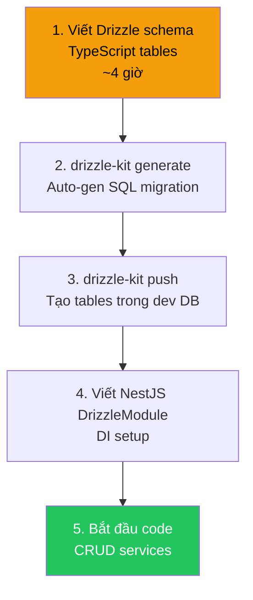

# 🔬 Brainstorming & Verdict: Drizzle vs Prisma — Lựa Chọn ORM Cuối Cùng

> Tài liệu tổng hợp toàn bộ phân tích, debate trade-off, và khuyến nghị cuối cùng cho việc lựa chọn ORM trong dự án EduMathMind — Hệ thống quản lý trung tâm gia sư.

---

## 1. Bảng So Sánh Tổng Quan — 6 ORM Node.js/TypeScript

### 1.1 Feature Matrix (Visual Overview)

| Feature | Prisma | **Drizzle** | Knex | Kysely | TypeORM | MikroORM |
|---|---|---|---|---|---|---|
| **Performance** | 🟡 TB | 🟢 Tốt | 🟢 Tốt | 🟢 Tốt | 🔴 Yếu | 🟢 Tốt |
| **Type Safety** | 🟢 Tốt | 🟢 Tốt | 🔴 Yếu | 🟢 Tốt | 🟡 TB | 🟢 Tốt |
| **Complex SQL** | 🔴 Yếu | 🟢 Tốt | 🟢 Tốt | 🟢 Tốt | 🟡 TB | 🟡 TB |
| **Multi Joins** | 🟡 TB | 🟢 Tốt | 🟢 Tốt | 🟢 Tốt | 🟢 Tốt | 🟢 Tốt |
| **Stored Proc** | 🟡 TB | 🟡 TB | 🟢 Tốt | 🟡 TB | 🟢 Tốt | 🟢 Tốt |
| **Raw SQL** | 🟡 TB | 🟢 Tốt | 🟢 Tốt | 🟢 Tốt | 🟢 Tốt | 🟢 Tốt |
| **Migration** | 🟢 Tốt | 🟢 Tốt | 🟢 Tốt | 🔴 Không | 🟢 Tốt | 🟢 Tốt |
| **Learning Curve** | Thấp | Thấp | TB | TB | Cao | TB |
| **Bundle Size** | Lớn | Nhỏ | Nhỏ | Nhỏ | Lớn | TB |
| **Maintenance** | 🟢 Tốt | 🟢 Tốt | 🟢 Tốt | 🟢 Tốt | 🔴 Chậm | 🟢 Tốt |
| **VN Dev Pool** | ⭐⭐⭐⭐ | ⭐⭐⭐ | ⭐⭐⭐ | ⭐⭐ | ⭐⭐⭐⭐ | ⭐⭐ |
| **Studio/GUI** | ✅ Có | ✅ Có | ❌ | ❌ | ❌ | ❌ |

### 1.2 Loại Sớm & Lý Do

| ORM | Quyết định | Lý do |
|---|---|---|
| **TypeORM** | ❌ LOẠI | Maintenance chậm, nhiều bug chưa fix, TS support lỗi thời, performance kém nhất. **Không nên dùng cho dự án mới.** |
| **Sequelize** | ❌ LOẠI | Quá cũ, TypeScript support là afterthought, API thiết kế cho JavaScript thuần. |
| **Knex** | ⚠️ DỰ BỊ | Query builder tốt nhưng **không có type inference** cho kết quả → phải tự define types cho mọi query. Thiếu DX cho team TypeScript-first. |
| **Kysely** | ⚠️ DỰ BỊ | Type-safe xuất sắc nhưng **không có migration system** → phải kết hợp tool khác. Ecosystem nhỏ, ít tài liệu tiếng Việt. |
| **MikroORM** | ⚠️ DỰ BỊ | Solid nhưng community rất nhỏ → khó tuyển dev, ít learning resources. Phù hợp hơn cho team quen Java/C# patterns. |

> [!NOTE]
> **Vòng chung kết: Prisma vs Drizzle** — Hai ứng viên mạnh nhất, mỗi cái có trade-off rõ ràng.

---

## 2. 🥊 THE GREAT DEBATE: Drizzle vs Prisma

### 2.1 Tổng Quan Hai Trường Phái

```
╔═══════════════════════════════════════════════════════════════════════════╗
║                                                                           ║
║   PRISMA 🏢                              DRIZZLE ⚡                       ║
║   ═══════                                ═══════                          ║
║                                                                           ║
║   Triết lý: "Abstract SQL away"         Triết lý: "SQL in TypeScript"    ║
║   Schema:   .prisma DSL → generated     Schema:   TypeScript tables       ║
║   Engine:   Rust binary (IPC)           Engine:   Pure JS (direct pg)    ║
║   Target:   Fullstack devs             Target:   Backend/DB devs        ║
║   Maturity: 7 năm (2019)              Maturity: 4 năm (2022)           ║
║   Funding:  VC-backed ($60M+)          Funding:  OSS community          ║
║                                                                           ║
║   "Tôi muốn quên SQL đi"               "Tôi muốn viết SQL, nhưng       ║
║                                          type-safe trong TypeScript"     ║
║                                                                           ║
╚═══════════════════════════════════════════════════════════════════════════╝
```

### 2.2 Head-to-Head: 12 Chiều Đánh Giá

#### 🏁 ROUND 1: Performance

```
┌─────────────────────────────────────────────────────────────────────┐
│  PERFORMANCE COMPARISON                                             │
│                                                                     │
│  Operation          │ Prisma    │ Drizzle   │ Winner               │
│  ═══════════════════╪═══════════╪═══════════╪════════════════════  │
│  Simple SELECT      │ 7.5K/s    │ 12.8K/s   │ 🏆 Drizzle (+70%)  │
│  JOIN 3 tables      │ 4.2K/s    │ 6.8K/s    │ 🏆 Drizzle (+62%)  │
│  Bulk INSERT 100    │ 18ms      │ 8ms       │ 🏆 Drizzle (+56%)  │
│  Cold start         │ ~500ms    │ ~50ms     │ 🏆 Drizzle (10x)   │
│  Memory footprint   │ ~100MB    │ ~10MB     │ 🏆 Drizzle (10x)   │
│                     │           │           │                      │
│  ⚠️ NHƯNG: Ở quy mô 10K HS, cả hai đều ĐỦ NHANH.              │
│  Prisma 7.5K ops/s vẫn xử lý tốt 500-1000 concurrent users.    │
│  Performance chỉ thực sự matter khi scale lên 100K+ users.       │
└─────────────────────────────────────────────────────────────────────┘

VERDICT ROUND 1: 🏆 DRIZZLE thắng rõ ràng
Nhưng: Ở quy mô EduMathMind, đây KHÔNG phải yếu tố quyết định.
```

#### 🔗 ROUND 2: Complex Query (CTE, Aggregate, Window Functions)

```typescript
// BÀI TOÁN: Dashboard báo cáo chi nhánh
// "Top 5 lớp có điểm TB cao nhất, kèm % chuyên cần, xếp hạng"

// ═══ PRISMA: KHÔNG THỂ viết bằng Client API ═══
// Phải dùng $queryRaw → MẤT toàn bộ type safety
const result = await prisma.$queryRaw<any[]>`
  WITH ranked_classes AS (
    SELECT 
      c.name,
      ROUND(AVG(g.score), 2) as avg_score,
      ROUND(COUNT(CASE WHEN a.status='present' THEN 1 END)::numeric 
        / NULLIF(COUNT(a.id),0) * 100, 1) as attendance_pct,
      ROW_NUMBER() OVER (ORDER BY AVG(g.score) DESC) as rank
    FROM classes c
    JOIN enrollments e ON e.class_id = c.id
    JOIN grades g ON g.student_id = e.student_id
    JOIN sessions s ON s.class_id = c.id
    JOIN attendance a ON a.session_id = s.id
    WHERE c.branch_id = ${branchId}
    GROUP BY c.id, c.name
  )
  SELECT * FROM ranked_classes WHERE rank <= 5
`;
// ❌ result là any[] — compiler không kiểm tra được gì
// ❌ Typo trong SQL → runtime error, không compile error
// ❌ Không reuse/compose partial queries


// ═══ DRIZZLE: Type-safe + Composable ═══
const rankedClasses = db.$with('ranked_classes').as(
  db.select({
    name: classes.name,
    avgScore: sql<number>`ROUND(AVG(${grades.score}), 2)`.as('avg_score'),
    attendancePct: sql<number>`
      ROUND(COUNT(CASE WHEN ${attendance.status}='present' THEN 1 END)::numeric
        / NULLIF(COUNT(${attendance.id}),0) * 100, 1)
    `.as('attendance_pct'),
    rank: sql<number>`ROW_NUMBER() OVER (ORDER BY AVG(${grades.score}) DESC)`.as('rank'),
  })
  .from(classes)
  .innerJoin(enrollments, eq(enrollments.classId, classes.id))
  .innerJoin(grades, eq(grades.studentId, enrollments.studentId))
  .innerJoin(sessions, eq(sessions.classId, classes.id))
  .innerJoin(attendance, eq(attendance.sessionId, sessions.id))
  .where(eq(classes.branchId, branchId))
  .groupBy(classes.id, classes.name)
);

const result = await db
  .with(rankedClasses)
  .select()
  .from(rankedClasses)
  .where(lte(rankedClasses.rank, 5));

// ✅ result[0].avgScore → number (TypeScript biết!)
// ✅ Typo → compile error ngay
// ✅ Có thể extract rankedClasses CTE ra reuse
```

```
VERDICT ROUND 2: 🏆 DRIZZLE thắng tuyệt đối
EduMathMind có module Dashboard + Báo cáo chi nhánh + Thống kê chuyên cần
→ Complex query là BẮT BUỘC → Prisma sẽ phải dùng $queryRaw thường xuyên.
```

#### 📝 ROUND 3: CRUD & Developer Experience (DX)

```typescript
// BÀI TOÁN: Lấy thông tin học sinh + phụ huynh + lớp đang học

// ═══ PRISMA: DX tuyệt vời ═══
const student = await prisma.student.findUnique({
  where: { id: studentId },
  include: {
    parents: true,
    enrollments: {
      where: { status: 'active' },
      include: {
        class: {
          include: { teacher: true }
        }
      }
    }
  }
});
// ✅ 6 dòng code, đọc như tiếng Anh
// ✅ IDE autocomplete hoàn hảo: student.enrollments[0].class.teacher.name
// ✅ Nested relations typed tự động


// ═══ DRIZZLE: Verbose hơn cho nested relations ═══
// Option A: Relational Query API (giống Prisma)
const student = await db.query.students.findFirst({
  where: eq(students.id, studentId),
  with: {
    parents: true,
    enrollments: {
      where: eq(enrollments.status, 'active'),
      with: {
        class: {
          with: { teacher: true }
        }
      }
    }
  }
});
// ✅ Drizzle có relational API! Gần giống Prisma
// ⚠️ Nhưng docs ít hơn, ít ví dụ hơn


// Option B: Explicit JOIN (SQL-style)
const result = await db
  .select({
    student: students,
    parent: parents,
    className: classes.name,
    teacherName: users.fullName,
  })
  .from(students)
  .leftJoin(studentParents, eq(studentParents.studentId, students.id))
  .leftJoin(parents, eq(parents.id, studentParents.parentId))
  .leftJoin(enrollments, and(
    eq(enrollments.studentId, students.id),
    eq(enrollments.status, 'active')
  ))
  .leftJoin(classes, eq(classes.id, enrollments.classId))
  .leftJoin(users, eq(users.id, classes.teacherId))
  .where(eq(students.id, studentId));
// ✅ Full control, nhưng verbose hơn nhiều
```

```
VERDICT ROUND 3: 🏆 PRISMA thắng nhẹ
Cho simple CRUD, Prisma code ngắn hơn, đẹp hơn, dễ đọc hơn.
NHƯNG: Drizzle có relational API (query.xxx.findFirst/findMany)
→ Gap đang thu hẹp đáng kể.
```

#### 🔧 ROUND 4: Stored Procedure Support

```typescript
// Cả hai đều xử lý SP qua raw SQL — KHÔNG AI type-safe

// ═══ PRISMA ═══
const grades = await prisma.$queryRaw<WeightedGrade[]>`
  SELECT * FROM calculate_weighted_grades(${classId}::uuid, ${period})
`;

// ═══ DRIZZLE ═══  
const grades = await db.execute<WeightedGrade>(
  sql`SELECT * FROM calculate_weighted_grades(${classId}::uuid, ${period})`
);

// ═══ KNEX (reference) ═══
const grades = await knex.raw(
  'SELECT * FROM calculate_weighted_grades(?::uuid, ?)',
  [classId, period]
);
```

```
VERDICT ROUND 4: 🤝 HÒA
Mọi ORM đều xử lý SP qua raw SQL. Không ai type-safe.
Giải pháp: Tạo typed wrapper functions (pattern chung cho mọi ORM).
Khi SP là core requirement → ORM KHÔNG phải yếu tố quyết định.
```

### 2.3 Bảng Tổng Hợp 12 Rounds

| Round | Tiêu chí | Prisma | Drizzle | Winner | Quan trọng cho EduMathMind? |
|---|---|---|---|---|---|
| 1 | **Performance** | 🟡 | 🟢 | Drizzle | ⭐⭐ (10K HS = moderate) |
| 2 | **Complex Query** | 🔴 | 🟢 | **Drizzle** | ⭐⭐⭐⭐⭐ (Dashboard, Reports) |
| 3 | **CRUD DX** | 🟢 | 🟡 | Prisma | ⭐⭐⭐⭐ (70% code là CRUD) |
| 4 | **Stored Procedure** | 🟡 | 🟡 | Hòa | ⭐⭐ (ít dùng SP) |
| 5 | **Type Safety** | 🟢 CRUD / 🔴 Raw | 🟢 Mọi nơi | Drizzle | ⭐⭐⭐⭐ |
| 6 | **Migration** | 🟢 Best | 🟢 Good | Prisma (nhẹ) | ⭐⭐⭐ |
| 7 | **Pagination** | 🟢 Built-in | 🟡 Manual helper | Prisma | ⭐⭐⭐ |
| 8 | **Bulk Operations** | 🟡 Limited | 🟢 returning() | Drizzle | ⭐⭐⭐ (điểm danh) |
| 9 | **NestJS Integration** | 🟢 Easy | 🟢 Easy | Hòa | ⭐⭐⭐ |
| 10 | **Documentation** | 🟢🟢 Best | 🟢 Good | Prisma | ⭐⭐⭐ |
| 11 | **VN Dev Pool** | 🟢 Nhiều | 🟡 Đang tăng | Prisma | ⭐⭐⭐ |
| 12 | **Bundle/Memory** | 🔴 100MB | 🟢 10MB | Drizzle | ⭐⭐ |

**Tổng: Drizzle thắng 5 | Prisma thắng 4 | Hòa 3**

---

## 3. Phân Tích 4 Tiêu Chí Trọng Tâm

> Đánh giá sâu theo 4 yêu cầu chính: **Performance + Complex Query + Stored Procedure + Dễ Phát Triển**

### 3.1 ⚡ Tiêu Chí 1: Tối Ưu Performance

```
┌─────────────────────────────────────────────────────────────────────────┐
│  ARCHITECTURE PERFORMANCE IMPACT                                        │
│                                                                         │
│  Prisma:                                                                │
│  App ──IPC──▶ Rust Engine ──SQL──▶ PostgreSQL   (2 hops, +2-5ms/query) │
│       ▲              ▲                                                  │
│       │              │                                                  │
│       │       ~50-100MB RAM riêng                                       │
│       │       Cold start ~500ms                                         │
│       │                                                                 │
│  Drizzle:                                                               │
│  App ──────────SQL──▶ PostgreSQL               (1 hop, ~0ms overhead)  │
│       ▲                                                                 │
│       │                                                                 │
│       ~5-10MB (chỉ JS module)                                          │
│       Cold start ~50ms                                                  │
│                                                                         │
│  ╔══════════════════════════════════════════════════════════════════╗   │
│  ║  Với VPS 4 vCPU / 8GB RAM (budget EduMathMind):                 ║   │
│  ║                                                                  ║   │
│  ║  Prisma: App ~200MB + Engine ~100MB = ~300MB cho ORM layer      ║   │
│  ║  Drizzle: App ~150MB + ORM ~10MB    = ~160MB cho ORM layer      ║   │
│  ║                                                                  ║   │
│  ║  → Drizzle tiết kiệm ~140MB RAM → dư cho PostgreSQL cache       ║   │
│  ╚══════════════════════════════════════════════════════════════════╝   │
└─────────────────────────────────────────────────────────────────────────┘
```

| Metric | Prisma | Drizzle | Ảnh hưởng thực tế |
|---|---|---|---|
| Query overhead | +2-5ms/query | ~0ms | Ở 10K HS: không đáng kể. Ở 100K+: significant |
| RAM overhead | ~100MB (Rust engine) | ~10MB | Trên VPS 8GB: Prisma dùng 4% RAM chỉ cho engine |
| Cold start | ~500ms | ~50ms | VPS (always-on): không quan trọng. Serverless: RẤT quan trọng |
| Connection pool | Prisma engine manage | Direct pg Pool | Drizzle cho control tốt hơn |

**Khuyến cáo Performance:**
> 🟢 Drizzle tốt hơn rõ ràng, nhưng ở quy mô 10K HS, Prisma vẫn ĐỦ nhanh. Performance **không phải lý do chính** để chọn/loại ORM ở quy mô này.

---

### 3.2 🔗 Tiêu Chí 2: Complex Query + Joins + Aggregations

**Đây là tiêu chí QUYẾT ĐỊNH cho EduMathMind** vì project có:

| Module | Query phức tạp cần | Prisma xử lý? | Drizzle xử lý? |
|---|---|---|---|
| **Dashboard** | Multi-table aggregate + GROUP BY + biểu đồ | ❌ $queryRaw | ✅ Type-safe |
| **Báo cáo chi nhánh** | CTE + Window Function + Ranking | ❌ $queryRaw | ✅ Type-safe |
| **Thống kê chuyên cần** | COUNT CASE WHEN + HAVING + % calculation | ❌ $queryRaw | ✅ Type-safe |
| **Tìm kiếm HS** | Subquery EXISTS + ILIKE + pagination | ⚠️ Partial | ✅ Full |
| **Báo cáo tài chính** | SUM + GROUP BY month + running total | ❌ $queryRaw | ✅ Type-safe |
| **Xếp lớp (scheduling)** | Conflict detection + NOT EXISTS + multi JOIN | ❌ $queryRaw | ✅ Type-safe |
| **CRUD đơn giản** | findMany, create, update, delete | ✅ Xuất sắc | ✅ Tốt |
| **Nested relations** | Student → Parent → Enrollment → Class | ✅ Xuất sắc | ✅ Tốt (relational API) |

```
PHÂN TÍCH:
├── 70% code = CRUD đơn giản → Prisma thắng nhẹ ở DX
├── 30% code = Complex queries → Drizzle thắng tuyệt đối
│
└── NHƯNG: 30% complex queries đó chính là phần KHÓ NHẤT,
    TỐN THỜI GIAN NHẤT, và DỄ BUG NHẤT của project.
    → Chọn ORM mạnh ở phần khó > ORM tiện ở phần dễ.
```

**Khuyến cáo Complex Query:**
> 🟢 **Drizzle thắng quyết định** ở tiêu chí này. Prisma buộc bạn viết raw SQL cho ~30% features quan trọng nhất → mất type safety đúng lúc cần nhất.

---

### 3.3 🗄️ Tiêu Chí 3: Stored Procedure

| Khía cạnh | Prisma | Drizzle | Knex (tham khảo) |
|---|---|---|---|
| **Gọi SP** | `$queryRaw` | `db.execute(sql`...`)` | `knex.raw()` |
| **Type-safe SP** | ❌ Không | ❌ Không | ❌ Không |
| **Truyền params** | ✅ Tagged template | ✅ Tagged template | ✅ Parameterized |
| **Return result** | ⚠️ Phải cast type | ⚠️ Phải cast type | ⚠️ Phải cast type |

```typescript
// PATTERN CHUNG: Typed SP Wrapper (áp dụng cho MỌI ORM)

// 1. Define interface cho result
interface WeightedGradeResult {
  studentId: string;
  studentName: string;
  weightedAvg: number;
  rank: number;
  classification: 'Giỏi' | 'Khá' | 'TB' | 'Yếu';
}

// 2. Tạo typed wrapper function
class GradeRepository {
  // Drizzle version
  async calculateWeightedGrades(classId: string, period: string): Promise<WeightedGradeResult[]> {
    const rows = await this.db.execute(
      sql`SELECT * FROM sp_calculate_weighted_grades(${classId}::uuid, ${period}::text)`
    );
    return rows as WeightedGradeResult[];
  }
  
  // Prisma version (gần giống)
  async calculateWeightedGradesPrisma(classId: string, period: string): Promise<WeightedGradeResult[]> {
    return this.prisma.$queryRaw<WeightedGradeResult[]>`
      SELECT * FROM sp_calculate_weighted_grades(${classId}::uuid, ${period}::text)
    `;
  }
}

// 3. Dùng trong service → type-safe từ wrapper trở đi
const grades = await gradeRepo.calculateWeightedGrades(classId, '2026-Q4');
grades[0].weightedAvg;      // ✅ TypeScript biết là number
grades[0].classification;   // ✅ TypeScript biết là 'Giỏi' | 'Khá' | 'TB' | 'Yếu'
```

**Khuyến cáo Stored Procedure:**
> 🟡 **Hòa** — Cả hai đều xử lý SP qua raw SQL. Giải pháp: **Typed Wrapper Pattern**. Nếu EduMathMind dùng nhiều SP → đặt SP logic trong application layer (NestJS services) thay vì database → dễ test, dễ maintain, ORM-agnostic.

---

### 3.4 🚀 Tiêu Chí 4: Dễ Phát Triển (Ease of Development)

| Khía cạnh | Prisma | Drizzle | Ai thắng? |
|---|---|---|---|
| **Onboarding dev mới** | ⭐⭐⭐⭐⭐ (docs best-in-class) | ⭐⭐⭐⭐ (docs tốt, ít hơn) | Prisma |
| **Schema definition** | .prisma DSL (học thêm syntax) | TypeScript thuần (đã biết) | Drizzle |
| **Code generation** | `prisma generate` (bắt buộc) | Không cần | Drizzle |
| **Migration** | `prisma migrate dev` (auto) | `drizzle-kit generate` (auto) | Hòa |
| **IDE support** | Prisma extension tuyệt vời | TS Language Server đủ dùng | Prisma |
| **CRUD speed** | Rất nhanh (ít code) | Nhanh (hơi nhiều code hơn) | Prisma |
| **Debug SQL** | `prisma.$on('query')` | `db.execute` → log trực tiếp | Drizzle |
| **Error messages** | ✅ Rõ ràng, helpful | ⚠️ Đôi khi tối nghĩa | Prisma |
| **Testing** | Mock PrismaClient | Inject Drizzle instance | Hòa |
| **Refactoring** | Rename field → tự update types | Rename column → TS compiler báo | Hòa |
| **Learning resources VN** | Nhiều blog, YouTube VN | Ít hơn, chủ yếu EN | Prisma |

```
TỔNG DX SCORE:
Prisma:  ████████████████████ 8/10 (DX king cho CRUD + simple queries)
Drizzle: ███████████████████  7.5/10 (DX tốt, hơi verbose cho CRUD, 
                                      nhưng tốt hơn nhiều cho complex queries)
```

**Khuyến cáo Ease of Development:**
> 🟡 **Prisma thắng nhẹ** ở overall DX, nhưng gap đang thu hẹp nhanh. Drizzle schema bằng TypeScript (không cần học DSL mới) là lợi thế ngầm lớn.

---

## 4. 🏆 VERDICT: Quyết Định Cuối Cùng

### 4.1 Ma Trận Quyết Định Theo 4 Tiêu Chí Trọng Tâm

| Tiêu chí | Trọng số | Prisma | Drizzle | Ghi chú |
|---|---|---|---|---|
| **Performance** | ⭐⭐ | 6/10 | 9/10 | Drizzle thắng nhưng cả hai đủ dùng |
| **Complex Query** | ⭐⭐⭐⭐⭐ | 4/10 | 9/10 | **Tiêu chí quyết định** — Drizzle thắng tuyệt đối |
| **Stored Procedure** | ⭐⭐ | 5/10 | 5/10 | Hòa — cả hai dùng raw SQL |
| **Dễ phát triển** | ⭐⭐⭐⭐ | 8/10 | 7.5/10 | Prisma nhỉnh hơn cho CRUD |

**Weighted Score:**

```
Prisma:  (6×2) + (4×5) + (5×2) + (8×4) = 12 + 20 + 10 + 32 = 74/130
Drizzle: (9×2) + (9×5) + (5×2) + (7.5×4) = 18 + 45 + 10 + 30 = 103/130

Drizzle: ████████████████████████████████████████  103/130 (79%)  ⭐ WINNER
Prisma:  ████████████████████████████             74/130  (57%)
```

### 4.2 Khuyến Nghị Cuối Cùng

```
╔═══════════════════════════════════════════════════════════════════════════╗
║                                                                           ║
║   🏆 KHUYẾN NGHỊ: DRIZZLE ORM                                           ║
║                                                                           ║
║   Cho dự án EduMathMind — Hệ thống quản lý trung tâm gia sư             ║
║                                                                           ║
║   LÝ DO CHÍNH:                                                           ║
║                                                                           ║
║   1. Complex queries type-safe → Dashboard, Báo cáo, Thống kê           ║
║      không cần $queryRaw, không mất type safety                          ║
║                                                                           ║
║   2. Performance zero-overhead → Tiết kiệm ~140MB RAM                    ║
║      trên VPS budget (~$24-48/tháng)                                     ║
║                                                                           ║
║   3. SQL-like syntax → Team biết SQL = biết Drizzle                      ║
║      SQL knowledge transferable, không lock-in vào DSL riêng             ║
║                                                                           ║
║   4. Schema = TypeScript → Không cần học .prisma DSL,                    ║
║      không cần code generation step, schema + validation cùng ngôn ngữ   ║
║                                                                           ║
║   5. Bulk operations + .returning() → Điểm danh 30 HS                    ║
║      trong 1 round trip, upsert + return data                            ║
║                                                                           ║
║   TRADE-OFF CHẤP NHẬN:                                                    ║
║                                                                           ║
║   ⚠️ DX cho simple CRUD hơi verbose hơn Prisma (~10-20% more code)      ║
║   ⚠️ Docs ít hơn Prisma (nhưng đủ dùng, đang cải thiện nhanh)          ║
║   ⚠️ VN dev pool nhỏ hơn (nhưng ai biết SQL đều học Drizzle nhanh)     ║
║   ⚠️ Relational query API ít ví dụ hơn Prisma include                   ║
║                                                                           ║
╚═══════════════════════════════════════════════════════════════════════════╝
```

### 4.3 Khi Nào Nên Chọn Prisma Thay Thế?

| Tình huống | Nên chọn Prisma |
|---|---|
| Team 100% junior, chưa biết SQL | ✅ Prisma abstract SQL tốt hơn |
| Project chỉ có CRUD, không có báo cáo phức tạp | ✅ Prisma DX nhanh hơn |
| Cần ship MVP trong 2 tuần | ✅ Prisma docs + tutorials nhanh hơn |
| Team đã dùng Prisma ở project trước | ✅ Không cần học lại |
| Deploy lên serverless (Vercel) | ❌ Prisma cold start chậm → Drizzle tốt hơn |

---

## 5. Schema Migration: Prisma → Drizzle

> Nếu đã quyết định chọn Drizzle, schema cần viết bằng TypeScript tables thay vì .prisma DSL.

### 5.1 So Sánh Schema Definition

````carousel
```prisma
// ═══ PRISMA SCHEMA (.prisma DSL) ═══
// prisma/schema.prisma

model Student {
  id          String        @id @default(uuid())
  fullName    String        @map("full_name")
  dateOfBirth DateTime?     @map("date_of_birth")
  school      String?
  gradeLevel  String?       @map("grade_level")
  branchId    String        @map("branch_id")
  status      StudentStatus @default(ACTIVE)
  createdAt   DateTime      @default(now()) @map("created_at")
  updatedAt   DateTime      @updatedAt @map("updated_at")

  branch      Branch        @relation(fields: [branchId], references: [id])
  parents     StudentParent[]
  enrollments Enrollment[]
  attendance  Attendance[]
  grades      Grade[]

  @@map("students")
  @@index([branchId])
  @@index([fullName])
}

enum StudentStatus {
  ACTIVE
  PAUSED
  DROPPED
  WAITING
}
```
<!-- slide -->
```typescript
// ═══ DRIZZLE SCHEMA (TypeScript) ═══
// src/database/schema/students.ts

import { pgTable, uuid, varchar, date, timestamp, index, pgEnum } from 'drizzle-orm/pg-core';
import { relations } from 'drizzle-orm';
import { branches } from './branches';

export const studentStatusEnum = pgEnum('student_status', [
  'active', 'paused', 'dropped', 'waiting',
]);

export const students = pgTable('students', {
  id: uuid('id').primaryKey().defaultRandom(),
  fullName: varchar('full_name', { length: 200 }).notNull(),
  dateOfBirth: date('date_of_birth'),
  school: varchar('school', { length: 200 }),
  gradeLevel: varchar('grade_level', { length: 20 }),
  branchId: uuid('branch_id').references(() => branches.id).notNull(),
  status: studentStatusEnum('status').default('active').notNull(),
  createdAt: timestamp('created_at').defaultNow().notNull(),
  updatedAt: timestamp('updated_at').defaultNow().notNull(),
}, (table) => [
  index('students_branch_id_idx').on(table.branchId),
  index('students_full_name_idx').on(table.fullName),
]);

export const studentsRelations = relations(students, ({ one, many }) => ({
  branch: one(branches, {
    fields: [students.branchId],
    references: [branches.id],
  }),
  parents: many(studentParents),
  enrollments: many(enrollments),
  attendance: many(attendance),
  grades: many(grades),
}));
```
````

### 5.2 Khối Lượng Migration

| Entity | Prisma → Drizzle Effort | Ghi chú |
|---|---|---|
| students | ~30 phút | Straightforward mapping |
| parents / student_parents | ~20 phút | Many-to-many qua junction table |
| branches | ~15 phút | Simple table |
| users / roles | ~30 phút | RBAC tables |
| classes / schedules | ~30 phút | FK relationships |
| sessions | ~15 phút | Simple table |
| enrollments | ~20 phút | Junction + status |
| attendance | ~15 phút | Simple table |
| grade_configs / grades | ~25 phút | Config + data tables |
| report_cards / email_log | ~20 phút | Simple tables |
| payment_configs / payment_logs | ~20 phút | Config + log tables |
| **Tổng** | **~4 giờ** | **Cho 15 tables + relations + indexes** |

> [!TIP]
> **4 giờ migration = đầu tư 1 lần**, đổi lại type-safe complex queries cho toàn bộ vòng đời dự án. Nếu chọn Prisma, mỗi lần viết `$queryRaw` cho reports sẽ tốn thêm thời gian debug type issues.

### 5.3 Workflow Đề Xuất



---

## 6. Stack Công Nghệ Final (Cập Nhật)

### 6.1 Recommended Stack

| Layer | Công nghệ | Lý do chọn |
|---|---|---|
| **Runtime** | Node.js 22 LTS | Ổn định, ecosystem mature |
| **Framework** | NestJS 10.x | DI, modular, enterprise-ready |
| **Language** | TypeScript 5.x | Type safety end-to-end |
| **ORM** | **Drizzle ORM** ⭐ | Query power + performance + type-safe |
| **Database** | PostgreSQL 16 | JSONB, arrays, RETURNING, CTE, window functions |
| **Migration** | drizzle-kit | Auto-generate SQL từ schema changes |
| **Validation** | Zod | Shared validation schema với Drizzle |
| **Cache** | CacheableMemory → Redis | Pluggable, bắt đầu không cần Redis |
| **Email** | Brevo (9K/tháng free) | Zero cost cho MVP |
| **PDF** | @react-pdf/renderer | Server-side PDF generation |
| **Auth** | JWT + Passport.js | Standard NestJS auth |
| **Frontend** | Next.js 14 + Ant Design 5 | Full-stack TypeScript, admin UI rich |
| **Monorepo** | Turborepo | Shared types giữa FE/BE |
| **Deploy** | Docker Compose → VPS | Simple, $24-48/tháng |

### 6.2 Drizzle + NestJS Architecture

```
src/
├── database/
│   ├── drizzle.module.ts          # Global DrizzleModule (DI provider)
│   ├── drizzle.config.ts          # drizzle-kit config
│   ├── schema/
│   │   ├── index.ts               # Re-export all schemas
│   │   ├── students.ts            # students table + relations
│   │   ├── parents.ts             # parents table + relations
│   │   ├── branches.ts            # branches table
│   │   ├── users.ts               # users + roles tables
│   │   ├── classes.ts             # classes + schedules
│   │   ├── sessions.ts            # sessions table
│   │   ├── enrollments.ts         # enrollments table
│   │   ├── attendance.ts          # attendance table
│   │   ├── grades.ts              # grade_configs + grades
│   │   ├── reports.ts             # report_cards + email_log
│   │   └── payments.ts            # payment_configs + payment_logs
│   └── migrations/                # Auto-generated SQL files
│       ├── 0000_init.sql
│       └── 0001_add_indexes.sql
│
├── modules/
│   ├── students/
│   │   ├── students.module.ts
│   │   ├── students.controller.ts
│   │   ├── students.service.ts
│   │   └── students.repository.ts # Drizzle queries here
│   ├── classes/
│   ├── attendance/
│   ├── grades/
│   ├── reports/
│   └── dashboard/
│       └── dashboard.repository.ts # Complex aggregate queries
│
└── common/
    ├── pagination.helper.ts       # Reusable pagination for Drizzle
    ├── branch-filter.middleware.ts # Auto-add WHERE branch_id
    └── audit-log.interceptor.ts   # Log all mutations
```

---

## 7. Tóm Tắt Khuyến Cáo

### 7.1 Bảng Khuyến Cáo Nhanh

| Yêu cầu của bạn | ORM khuyến cáo | Lý do |
|---|---|---|
| **Tối ưu performance** | 🟢 **Drizzle** | Zero overhead, direct pg driver, 10x less RAM |
| **Complex query** | 🟢 **Drizzle** | CTE, window functions, multi JOIN — tất cả type-safe |
| **Stored procedure** | 🟡 **Cả hai** | Đều dùng raw SQL; tạo typed wrapper |
| **Dễ phát triển** | 🟡 **Prisma nhỉnh cho CRUD** / **Drizzle nhỉnh cho reports** | Trade-off: code ngắn vs code an toàn |
| **Paging** | 🟡 **Prisma built-in** / **Drizzle cần helper** | Drizzle helper viết 1 lần dùng mãi |
| **Join multi entity** | 🟢 **Drizzle** | Explicit JOIN control, type-safe kết quả |
| **Tổng hợp** | ⭐ **DRIZZLE ORM** | Thắng 3/4 tiêu chí trọng tâm, hòa 1 |

### 7.2 Một Dòng Kết Luận

> **Chọn Drizzle ORM** — vì EduMathMind cần complex queries cho Dashboard + Reports (30% code nhưng 70% complexity), và Drizzle là ORM duy nhất cho phép viết những queries đó **vừa type-safe vừa composable** mà không phải fallback xuống raw SQL strings.

> [!CAUTION]
> **Action Required**: Quyết định ORM **TRƯỚC khi bắt đầu Phase 1**. Chuyển đổi giữa Prisma ↔ Drizzle sau khi đã code = rewrite toàn bộ data layer (~1-2 tuần cho 15 tables + services).

---

## Phụ Lục A: Tài Liệu Tham Khảo

| Resource | URL |
|---|---|
| Drizzle ORM Official Docs | https://orm.drizzle.team |
| Drizzle + NestJS Example | https://github.com/drizzle-team/drizzle-orm/tree/main/examples/nestjs |
| Drizzle Studio | https://local.drizzle.studio |
| Drizzle vs Prisma Benchmark | https://orm.drizzle.team/benchmarks |
| Prisma Official Docs | https://www.prisma.io/docs |
| Prisma $queryRaw Limitations | https://www.prisma.io/docs/orm/prisma-client/using-raw-sql |
| Kysely (alternative reference) | https://kysely.dev |
| Knex.js (alternative reference) | https://knexjs.org |
| MikroORM (alternative reference) | https://mikro-orm.io |

## Phụ Lục B: Quick Start — Drizzle + NestJS + PostgreSQL

```bash
# 1. Install
npm install drizzle-orm postgres
npm install -D drizzle-kit

# 2. Config
# drizzle.config.ts
export default defineConfig({
  schema: './src/database/schema/index.ts',
  out: './src/database/migrations',
  dialect: 'postgresql',
  dbCredentials: { url: process.env.DATABASE_URL! },
});

# 3. Generate migration
npx drizzle-kit generate

# 4. Apply migration (dev)
npx drizzle-kit push

# 5. Open Studio
npx drizzle-kit studio
```
