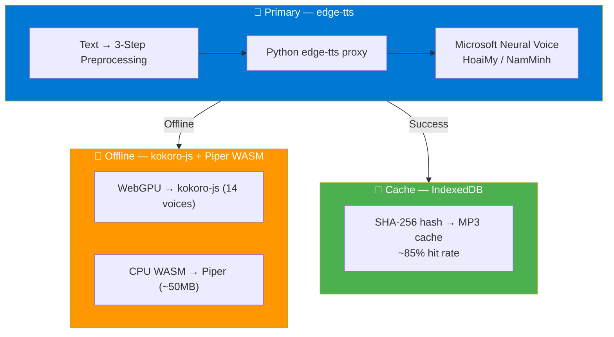

# 🔊 Vietnamese TTS Research Hub

> Nghiên cứu toàn diện về giải pháp Text-to-Speech tiếng Việt cho trang tài liệu kỹ thuật — từ khảo sát giải pháp, so sánh trade-off, đến kiến trúc hybrid 4 engine và triển khai production.

---

## 📑 Tài Liệu

### 🔬 Research & So Sánh

**[📊 Vietnamese TTS Research](/guides/tts-research/vietnamese-tts-research)** — Tài liệu nghiên cứu toàn diện

Khảo sát 15+ giải pháp TTS (cloud, self-hosted, browser), ma trận so sánh chi tiết, 5 rounds debate, trade-off analysis, và kết luận chọn giải pháp tối ưu.

**Nội dung chính:**
- 🗺️ Bản đồ giải pháp: Cloud APIs, Browser Native, SOTA Self-Hosted
- 📊 Ma trận so sánh: edge-tts vs Kokoro-Vi vs Piper WASM vs VieNeu-TTS
- ⚖️ Trade-off Analysis: chi phí vs chất lượng, latency vs complexity, privacy vs quality
- 🏟️ 5 Rounds Debate với Final Verdict
- 🔤 Bilingual Handler: 390 thuật ngữ Anh→Việt phiên âm
- 📝 12 bài học từ production deployment

---

### 🏗️ Architecture & Implementation

**[🏗️ Hybrid TTS Architecture](/guides/tts-research/tts-hybrid-architecture)** — Kiến trúc kỹ thuật chi tiết

Thiết kế kiến trúc hybrid 4 engine (edge-tts + kokoro-js + Piper WASM + VieNeu), smart engine router, preprocessing pipeline, và production hardening.

**Nội dung chính:**
- 🧠 Smart Engine Router: scoring-based engine selection
- 📝 3-Step Vietnamese NLP Pipeline: Dictionary → Bilingual → Normalize
- 💾 Smart Cache Layer: SHA-256 keyed IndexedDB cache
- 🎙️ Voice Switching: realtime voice change mechanism
- 🛡️ Production Hardening: SSML sanitization, serial queue, memory management
- 📂 File Structure & TypeScript Interfaces

---

## 🎯 Tóm Tắt Kiến Trúc

## 📈 Trạng Thái Hiện Tại

| Component | Status | Chi tiết |
|:---|:---|:---|
| **edge-tts Engine** | ✅ Production | Python backend, 2 voices (HoaiMy/NamMinh) |
| **Preprocessing Pipeline** | ✅ Production | 390 bilingual terms + 60 abbreviations + normalizer |
| **IndexedDB Cache** | ✅ Production | SHA-256 keyed, ~85% hit rate |
| **Voice Switching** | ✅ Production | Realtime switch, cache per voice |
| **TTSPlayer UI** | ✅ Production | 760+ LOC, keyboard shortcuts, progress tracking |
| **kokoro-js (Offline)** | 🔲 Planned | 14 Vietnamese voices, WebGPU/WASM |
| **Piper WASM (Offline)** | 🔲 Planned | Lightweight fallback, ~50MB model |
| **VieNeu-TTS (Premium)** | 🔲 Planned | SOTA Vietnamese, 48kHz, voice cloning |

## 💰 Chi Phí Vận Hành

| Scale | Chi phí/tháng |
|:---|:---|
| 50 pages, 100 visitors | **$0** |
| 500 pages, 10K visitors | **$0** |
| 1000 pages, 100K visitors | **$0** |
