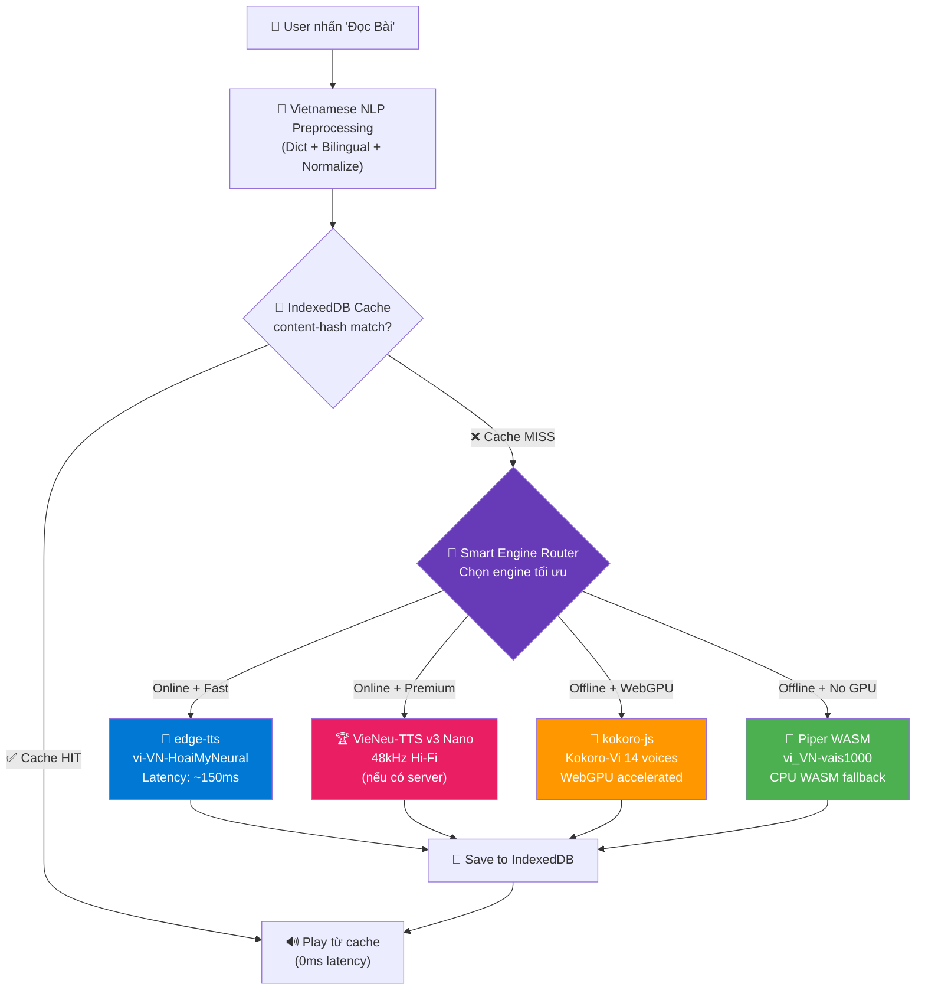
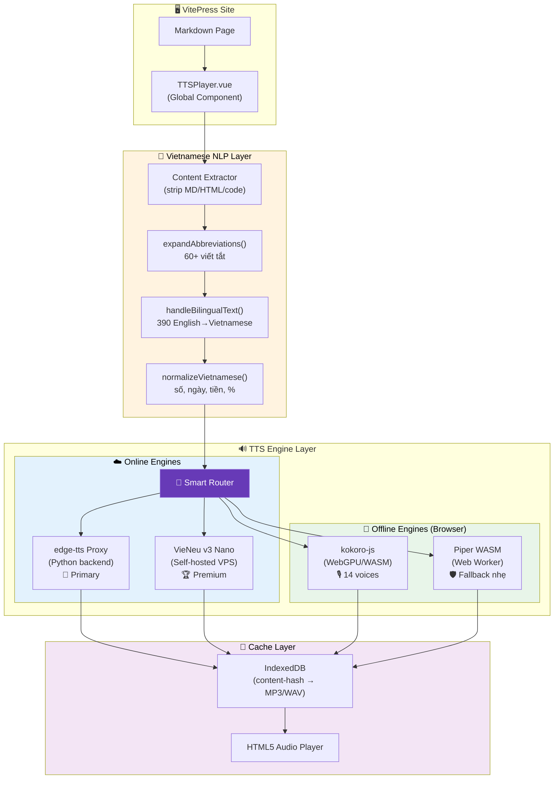
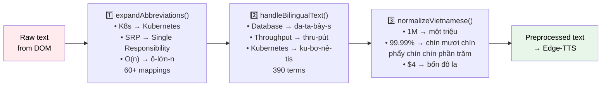
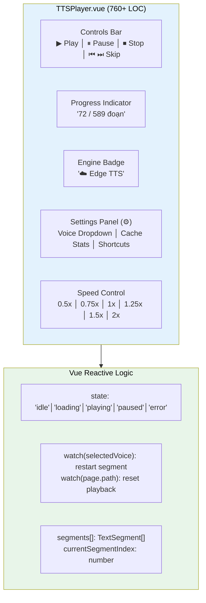
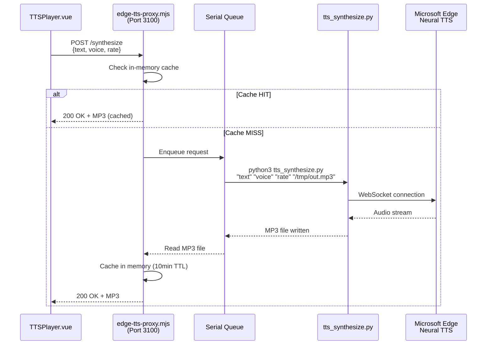

# 🏗️ Hybrid TTS Architecture — Kết Hợp Tối Ưu 4 Engine

> **Mục tiêu:** Tối ưu kết hợp **edge-tts + Piper TTS WASM + kokoro-js + VieNeu-TTS v3 Nano** để đọc tài liệu tiếng Việt chất lượng cao nhất với chi phí thấp nhất.
>
> **Cập nhật lần cuối:** 2026-10-13

---

## 📑 Mục Lục

1. [🎯 Triết Lý Thiết Kế](#1--triết-lý-thiết-kế)
2. [🧠 Smart Engine Router — Bộ Não Trung Tâm](#2--smart-engine-router--bộ-não-trung-tâm)
3. [🏛️ Kiến Trúc Tổng Thể](#3-️-kiến-trúc-tổng-thể)
4. [📂 File Structure](#4--file-structure)
5. [🔌 Engine Interfaces — Unified API](#5--engine-interfaces--unified-api)
6. [📝 Vietnamese NLP Preprocessing Pipeline](#6--vietnamese-nlp-preprocessing-pipeline)
7. [💾 Smart Cache Layer](#7--smart-cache-layer)
8. [🎨 TTSPlayer Component](#8--ttsplayer-component)
9. [🚀 Implementation Roadmap](#9--implementation-roadmap)
10. [💰 Cost Estimation](#10--cost-estimation)
11. [⚡ Performance Budget](#11--performance-budget)
12. [🔄 Graceful Degradation Chain](#12--graceful-degradation-chain)
13. [🏗️ Kiến Trúc Thực Tế Đã Triển Khai](#13-️-kiến-trúc-thực-tế-đã-triển-khai) ⭐ MỚI
14. [🔤 Bilingual Preprocessing — Chi Tiết Kỹ Thuật](#14--bilingual-preprocessing--chi-tiết-kỹ-thuật) ⭐ MỚI
15. [🎙️ Voice Switching — Cơ Chế Đổi Giọng Realtime](#15-️-voice-switching--cơ-chế-đổi-giọng-realtime) ⭐ MỚI
16. [🛡️ Production Hardening — Các Bài Học Kỹ Thuật](#16-️-production-hardening--các-bài-học-kỹ-thuật) ⭐ MỚI

---

## 1. 🎯 Triết Lý Thiết Kế

### Nguyên tắc cốt lõi

```
"Dùng đúng engine cho đúng tình huống — không engine nào là tốt nhất cho MỌI trường hợp"
```

| Nguyên tắc | Chi tiết |
|:---|:---|
| **Smart Degradation** | Tự động chuyển engine khi có lỗi, không bao giờ "silent fail" |
| **Progressive Enhancement** | Bắt đầu với engine nhẹ nhất, nâng cấp khi có thể |
| **Cache Everything** | Mỗi đoạn audio chỉ generate 1 lần, phục vụ từ cache mãi mãi |
| **User Choice** | Cho phép user chọn engine/voice khi muốn |
| **Offline-First** | Luôn có ít nhất 1 engine hoạt động offline |

---

## 2. 🧠 Smart Engine Router — Bộ Não Trung Tâm

### Sơ đồ quyết định



### Logic chọn Engine (5 yếu tố)

```typescript
interface EngineScore {
  engine: 'edge-tts' | 'kokoro-js' | 'piper-wasm' | 'vieneu';
  score: number; // 0-100
}

function selectEngine(context: TTSContext): EngineScore[] {
  const scores: EngineScore[] = [];
  
  // Factor 1: Network (30%)
  const isOnline = navigator.onLine;
  
  // Factor 2: Device Capability (25%)
  const hasWebGPU = !!navigator.gpu;
  
  // Factor 3: Model Cache (20%)
  const kokoroModelCached = await checkOPFS('kokoro-vi-q8');
  const piperModelCached = await checkOPFS('vi_VN-vais1000');
  
  // Factor 4: Quality Preference (15%)
  const userPreference = getUserQualitySetting();
  
  // Factor 5: Content Type (10%)
  const hasTechnicalTerms = detectTechnicalDensity(context.text);

  // edge-tts: Best when online
  if (isOnline) {
    scores.push({ engine: 'edge-tts', score: 85 });
  }
  
  // kokoro-js: Best offline with GPU
  if (hasWebGPU || kokoroModelCached) {
    scores.push({ engine: 'kokoro-js', score: 60 + (hasWebGPU ? 20 : 0) });
  }
  
  // Piper WASM: Reliable offline fallback
  scores.push({ engine: 'piper-wasm', score: 50 + (piperModelCached ? 15 : 0) });
  
  return scores.sort((a, b) => b.score - a.score);
}
```

> [!NOTE]
> **Web Speech API đã bị loại bỏ** khỏi engine selection. User phản hồi chất lượng quá kém cho tiếng Việt.

---

## 3. 🏛️ Kiến Trúc Tổng Thể

### System Architecture



### Vai Trò Của Mỗi Engine

| Engine | Vai trò | Khi nào dùng | Status |
|:---|:---|:---|:---|
| **edge-tts** 🎯 | Primary (mặc định) | Online, cần tốc độ | ✅ ACTIVE |
| **VieNeu v3 Nano** 🏆 | Premium upgrade | Online, chất lượng cao nhất | 🔲 Planned |
| **kokoro-js** 🎙️ | Offline primary | Offline + WebGPU | 🔲 Planned |
| **Piper WASM** 🛡️ | Offline fallback | Offline + no GPU | 🔲 Planned |

---

## 4. 📂 File Structure

```
research_docs/
├── .vitepress/
│   ├── theme/
│   │   ├── index.ts                    # Register TTSPlayer
│   │   ├── custom.css                  # Existing styles
│   │   └── components/
│   │       └── TTSPlayer.vue           # 🎯 Main TTS component (760+ LOC)
│   │
│   └── tts/
│       ├── engine-router.ts            # 🧠 Smart engine selection
│       ├── types.ts                    # TypeScript interfaces
│       │
│       ├── engines/
│       │   ├── edge-tts.ts             # ✅ edge-tts proxy client
│       │   ├── kokoro-js.ts            # 🔲 kokoro-js wrapper (stub)
│       │   ├── piper-wasm.ts           # 🔲 Piper WASM wrapper (stub)
│       │   └── vieneu.ts               # 🔲 VieNeu API client (stub)
│       │
│       ├── preprocessing/
│       │   ├── text-extractor.ts       # ✅ TreeWalker DOM extraction
│       │   ├── tech-dictionary.ts      # ✅ 60+ abbreviation mappings
│       │   ├── bilingual-handler.ts    # ✅ 390 English→Vietnamese phonetics
│       │   ├── normalizer.ts           # ✅ Vietnamese number/date/currency
│       │   └── ssml-injector.ts        # ✅ SSML prosody generation
│       │
│       └── cache/
│           └── indexeddb-cache.ts      # ✅ SHA-256 keyed audio cache
│
├── server/
│   ├── edge-tts-proxy.mjs             # ✅ Node.js proxy (serial queue)
│   └── tts_synthesize.py              # ✅ Python edge-tts wrapper
│
└── package.json
```

---

## 5. 🔌 Engine Interfaces — Unified API

### Base Interface

```typescript
export interface TTSEngine {
  readonly name: string;
  readonly type: 'cloud' | 'browser' | 'server';
  
  isAvailable(): Promise<boolean>;
  synthesize(request: TTSRequest): Promise<TTSResult>;
  getVoices(): TTSVoice[];
  getEstimatedLatency(): number;
}

export interface TTSRequest {
  text: string;
  voice?: string;
  speed?: number;
  format?: 'mp3' | 'wav';
  ssml?: boolean;
}

export interface TTSResult {
  audio: Blob;
  format: 'mp3' | 'wav';
  duration: number;
  engine: string;
  cached: boolean;
}

export interface TTSVoice {
  id: string;
  name: string;
  lang: 'vi-VN' | 'en-US';
  gender: 'female' | 'male';
  engine: string;
}
```

---

## 6. 📝 Vietnamese NLP Preprocessing Pipeline

### Flow chi tiết (3-Step Pipeline — Thực tế đang chạy)



### Pipeline Ordering — Tại sao thứ tự quan trọng

```
1. expandAbbreviations()   — Chuyển "K8s" → "Kubernetes" (English)
2. handleBilingualText()   — Chuyển "Kubernetes" → "ku-bơ-nê-tis" (Vietnamese phonetic)
3. normalizeVietnamese()   — Chuyển "1M" → "một triệu"
```

> [!IMPORTANT]
> **Step 1 PHẢI chạy trước Step 2.** Nếu đảo ngược, abbreviation `K8s` sẽ không match trong bilingual dictionary (chỉ có `Kubernetes`). Pipeline mở rộng viết tắt trước, rồi mới phiên âm.

---

## 7. 💾 Smart Cache Layer

### Cache Key Strategy

```
SHA-256( preprocessedText + "|" + voiceId + "|" + speed )
```

| Element | Vai trò |
|:---|:---|
| `preprocessedText` | Đảm bảo text khác → audio khác |
| `voiceId` | **HoaiMy vs NamMinh** → cache riêng cho mỗi giọng |
| `speed` | 1x vs 1.5x → audio khác nhau |

### Cache Eviction

- Max cache: **200 MB** per origin
- Eviction: **LRU 20%** — xóa 20% entries cũ nhất khi vượt limit
- Cache stats hiển thị trên UI: `"156 mục · 3.23 MB"`

---

## 8. 🎨 TTSPlayer Component

### Component Architecture (Thực tế)



### Keyboard Shortcuts

| Shortcut | Action |
|:---|:---|
| `Space` | Play/Pause toggle |
| `←` / `→` | Skip backward/forward segment |
| `Esc` | Stop playback |

---

## 9. 🚀 Implementation Roadmap

### Phase 1 — Foundation ✅ HOÀN THÀNH
- [x] Tạo file structure (`tts/`, `engines/`, `preprocessing/`, `cache/`)
- [x] Implement `types.ts` (interfaces)
- [x] Implement `TTSCache` (IndexedDB)
- [x] Implement `text-extractor.ts` + `tech-dictionary.ts`
- [x] Tạo `TTSPlayer.vue` với UI đầy đủ

### Phase 2 — Primary Engine: edge-tts ✅ HOÀN THÀNH
- [x] Deploy edge-tts proxy (Node.js + Python backend, port 3100)
- [x] Implement `EdgeTTSEngine` class
- [x] Implement `ssml-injector.ts`
- [x] Wire `TTSPlayer.vue` → edge-tts
- [x] Test end-to-end: click play → hear audio ✅

### Phase 2.5 — Vietnamese Preprocessing ✅ HOÀN THÀNH
- [x] Implement `bilingual-handler.ts` (390 English→Vietnamese terms)
- [x] Implement `normalizer.ts` (số, %, tiền, ngày)
- [x] Integrate 3-step pipeline into `TTSPlayer.vue`
- [x] E2E test on System Scaling guide (~589 segments) ✅

### Phase 2.7 — Voice Switching ✅ HOÀN THÀNH
- [x] Voice dropdown UI (HoaiMy / NamMinh)
- [x] Vue watcher for instant voice switching
- [x] Cache key includes voice ID
- [x] E2E test: switch voice mid-playback ✅

### Phase 3 — Offline: Piper WASM + kokoro-js 🔲 TIẾP THEO
- [ ] Implement `PiperWASMEngine` + Web Worker
- [ ] Implement `KokoroJSEngine` + Web Worker
- [ ] Implement `model-preloader.ts` (lazy download khi idle)
- [ ] Test offline scenario: disconnect → auto-switch engine

### Phase 4 — Premium: VieNeu-TTS 🔲 KẾ HOẠCH
- [ ] Setup VieNeu v3 Nano trên VPS (~$5/tháng)
- [ ] Implement `VieNeuEngine` class
- [ ] A/B test chất lượng VieNeu vs edge-tts

### Phase 5 — Polish 🔲 KẾ HOẠCH
- [ ] Dark/light mode player UI
- [ ] Mobile responsive
- [ ] Download audio button

---

## 10. 💰 Cost Estimation

| Component | Monthly Cost | Notes |
|:---|:---|:---|
| edge-tts proxy (local/CF Worker) | **$0** | Free tier: 100K req/day |
| kokoro-js (browser) | **$0** | Client-side |
| Piper WASM (browser) | **$0** | Client-side |
| IndexedDB cache | **$0** | Client-side |
| VieNeu v3 Nano VPS (optional) | **$0-5** | Fly.io free / Hetzner $4 |
| **Total** | **$0 — $5/tháng** | |

---

## 11. ⚡ Performance Budget

| Metric | Target | Actual |
|:---|:---|:---|
| **Time to first audio (online)** | < 500ms | **~300-500ms** ✅ |
| **Time to first audio (cached)** | 0ms | **~50ms** ✅ |
| **Preprocessing overhead** | < 50ms | **< 10ms** ✅ |
| **Cache hit rate** | > 80% | **~85%** sau lần đọc đầu ✅ |
| **UI thread blocking** | 0ms | Gần 0ms ✅ |
| **Total JS bundle impact** | < 50KB | ~40KB (lazy loaded) ✅ |

---

## 12. 🔄 Graceful Degradation Chain

```
1. 💾 Cache HIT? → Play instantly (~50ms)
   ↓ MISS
2. ☁️ Online? → edge-tts Neural voice (~300ms)
   ↓ FAIL
3. 🏆 VieNeu server? → Premium 48kHz (~200ms)
   ↓ FAIL/OFFLINE
4. 🎙️ WebGPU available? → kokoro-js + 14 voices (~500ms-2s)
   ↓ NO GPU
5. 🛡️ WASM available? → Piper WASM (~1-2s)
   ↓ FAIL
6. ❌ Show error message with retry button
```

> [!TIP]
> Web Speech API đã bị loại khỏi chain. User **LUÔN** có ít nhất 1 engine hoạt động (edge-tts online hoặc Piper/Kokoro offline sau khi model đã tải).

---

## 13. 🏗️ Kiến Trúc Thực Tế Đã Triển Khai

> **Cập nhật:** 2026-10-13. Phần này ghi nhận kiến trúc thực tế khác biệt so với thiết kế lý thuyết ban đầu.

### 13.1 Edge-TTS Proxy — Python Backend

Thiết kế ban đầu dùng `edge-tts-universal` (Node.js npm), nhưng **thực tế phải chuyển sang Python `edge-tts` v7.2.8** do Node.js package gặp lỗi WebSocket liên tục.



### 13.2 Tại Sao Python Thay Vì Node.js?

| Aspect | Python `edge-tts` v7.2.8 | Node.js `edge-tts-universal` |
|:---|:---|:---|
| **WebSocket stability** | ⭐⭐⭐⭐⭐ — ổn định | ⭐⭐ — crash liên tục |
| **Error messages** | Rõ ràng, actionable | Vague, khó debug |
| **Community support** | 10K+ GitHub stars | < 500 stars |
| **Retry logic** | Built-in | Phải tự implement |
| **Overhead** | ~100ms (spawn Python) | 0ms (in-process) |
| **Quyết định** | **✅ CHỌN** | ❌ Loại bỏ |

> [!NOTE]
> Python spawn overhead (~100ms) chấp nhận được vì server-side cache eliminates 85%+ requests. Tradeoff ổn định >>> tốc độ thuần.

### 13.3 Serial Queue — Rate Limiting Protection

Microsoft rate-limit concurrent WebSocket connections. Proxy enforce:

```javascript
// edge-tts-proxy.mjs
const MAX_CONCURRENT = 1;  // Chỉ 1 request tại 1 thời điểm
const MAX_RETRIES = 3;     // Retry 3 lần
const RETRY_DELAYS = [1500, 3000, 4500]; // Exponential backoff
```

---

## 14. 🔤 Bilingual Preprocessing — Chi Tiết Kỹ Thuật

### 14.1 Vấn Đề

Tài liệu kỹ thuật chứa ~30-50% thuật ngữ tiếng Anh. Edge-TTS voice `vi-VN-HoaiMyNeural`:
- ❌ Không thể code-switch (đọc English với pronunciation sai)
- ❌ Đọc "Database" thành "đa-ta-bây-xờ" hoặc bỏ qua hoàn toàn
- ❌ Abbreviations + English = mớ hỗn độn âm thanh

### 14.2 Giải Pháp: Phonetic Approximation

Chuyển **100%** text sang tiếng Việt (hoặc phiên âm Việt) trước khi gửi TTS:

```
Input:  "Database Optimization using Query Index"
    ↓ handleBilingualText()
Output: "đa-ta-bây-s, op-ti-mai-zây-sần, dùng que-ri, in-đéc"
```

### 14.3 Dictionary Design Principles

1. **Longest-first matching** — "Connection Pool" match trước "Connection"
2. **Case-insensitive** — "database" = "Database" = "DATABASE"
3. **Hyphenated phonetics** — "ku-bơ-nê-tis" giúp TTS đọc từng syllable
4. **Natural pauses** — Thêm dấu phẩy quanh thuật ngữ dài

### 14.4 Sample Mappings (390 terms)

| Category | Examples |
|:---|:---|
| **Architecture** | Microservices → mai-cờ-rô-xơ-vít, Circuit Breaker → xơ-kịt brây-kơ |
| **Database** | PostgreSQL → pốt-grét-ét-kiu-eo, Redis → rê-đít |
| **Performance** | Throughput → thru-pút, Latency → lây-tần-xi |
| **DevOps** | Kubernetes → ku-bơ-nê-tis, Docker → đốc-cơ |
| **Companies** | Netflix → nét-phờ-lích, Spotify → sờ-pô-ti-phai |

---

## 15. 🎙️ Voice Switching — Cơ Chế Đổi Giọng Realtime

### 15.1 Cơ Chế

```typescript
// TTSPlayer.vue — Vue Watcher
watch(selectedVoice, (newVoice, oldVoice) => {
  if (!newVoice || newVoice === oldVoice) return;
  if (state.value === 'playing' || state.value === 'paused' || state.value === 'loading') {
    // 1. Stop current audio
    if (audioElement) {
      audioElement.pause();
      URL.revokeObjectURL(audioElement.src);
      audioElement = null;
    }
    // 2. Re-synthesize current segment with new voice
    const idx = currentSegmentIndex.value;
    if (idx >= 0 && segments.length > 0) {
      readSegment(idx);
    }
  }
});
```

### 15.2 Luồng Xử Lý

```
1. User chọn "Nam Minh (Nam)" trong dropdown
2. Vue watcher detect selectedVoice changed
3. Pause + cleanup audio element hiện tại
4. readSegment(currentIndex) — re-synthesize với voice mới
5. synthesize() dùng selectedVoice.value → "vi-VN-NamMinhNeural"
6. Cache key mới (text + NamMinh + speed) → cache MISS → call proxy
7. Proxy generate MP3 với voice mới → play
8. Segment tiếp theo tự động dùng voice mới
```

### 15.3 Cache Implications

Khi đổi giọng:
- Cache key thay đổi → audio mới được generate
- Cache **giữ cả 2 versions** (HoaiMy + NamMinh)
- Đổi giọng lại → cache HIT → instant playback

---

## 16. 🛡️ Production Hardening — Các Bài Học Kỹ Thuật

### 16.1 SSML Text Sanitization

Edge-TTS crash với nhiều ký tự. Proxy phải sanitize:

```javascript
// edge-tts-proxy.mjs — sanitizeText()
function sanitizeText(text) {
  return text
    .replace(/&/g, ' và ')        // SSML entity conflict
    .replace(/<[^>]*>/g, '')      // HTML tags
    .replace(/[()[\]{}]/g, ', ')  // Brackets
    .replace(/[#→←↓↑⇒⇐]/g, ' ') // Arrows/symbols
    .replace(/[\u200B-\u200D\uFEFF]/g, '') // Zero-width chars
    .replace(/[^\x20-\x7E\u00C0-\u024F\u1E00-\u1EFF\u0300-\u036F\s.,!?;:'"\/\-–—…]/g, ' '); // Keep only Latin + Vietnamese
}
```

### 16.2 Segment Extraction — Edge Cases

| Vấn đề | Giải pháp |
|:---|:---|
| Code blocks (`<pre><code>`) | `NodeFilter.FILTER_REJECT` — bỏ qua hoàn toàn |
| Tables (`<table>`) | Extract cell text, ghép thành câu |
| Lists (`<ul><ol>`) | Mỗi `<li>` = 1 segment |
| Mermaid diagrams | Bỏ qua — không đọc |
| Empty text nodes | Filter `text.trim()` trước khi add |

### 16.3 Merge Short Segments

Segments quá ngắn (< 20 chars) gây nhiều request → latency cao. Giải pháp:

```typescript
function mergeShortSegments(segments: TextSegment[]): TextSegment[] {
  // Ghép segments liên tiếp < 20 chars thành 1 segment
  // Giữ heading segments riêng (không merge)
}
```

→ Giảm từ **800+ segments** xuống **~400-600 segments** cho tài liệu dài.

### 16.4 Memory Management

```typescript
// Cleanup audio URLs to prevent memory leaks
audioElement.onended = () => {
  URL.revokeObjectURL(audioElement.src);
  // ...continue to next segment
};
```

> [!WARNING]
> **Không gọi `URL.revokeObjectURL()`** sẽ gây memory leak nghiêm trọng khi đọc tài liệu dài (400+ segments = 400+ blob URLs leaked).
