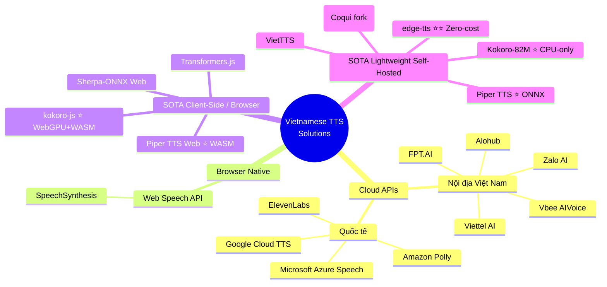
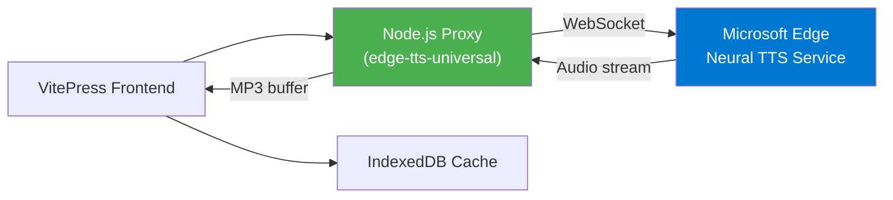
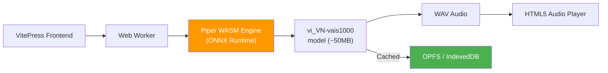
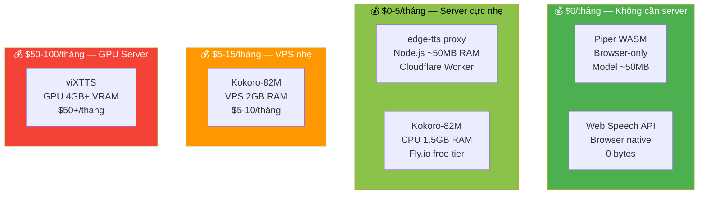
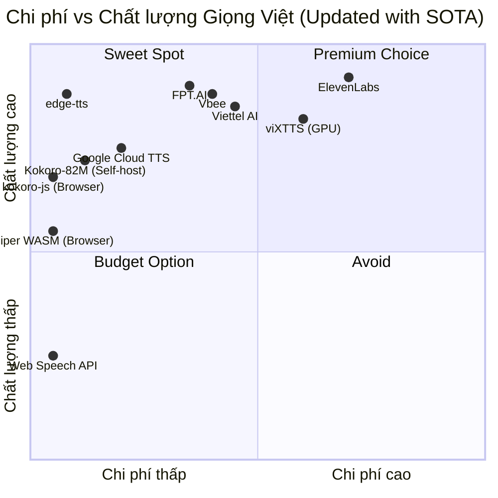
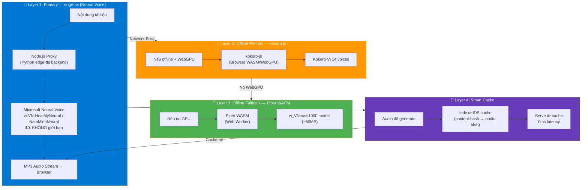
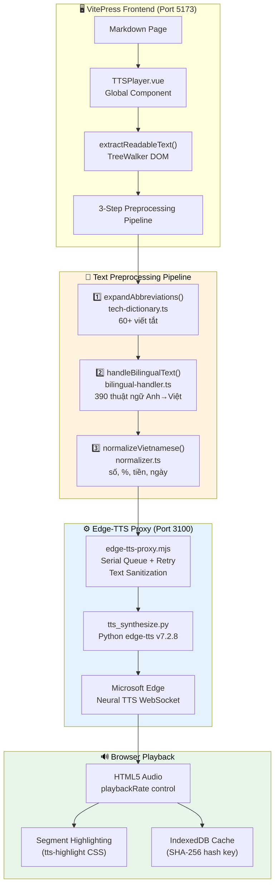
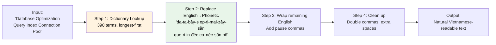
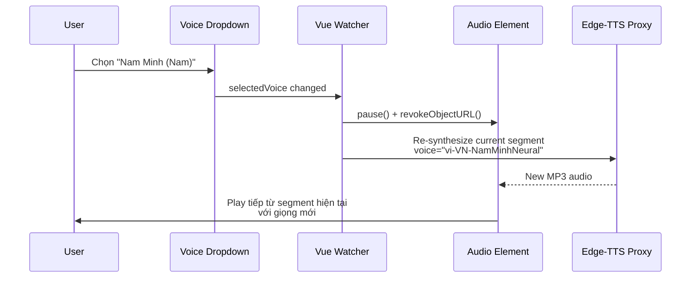

# 🔊 Research: Vietnamese Text-to-Speech cho VitePress Documentation

> **Mục tiêu:** Tìm giải pháp tối ưu để tích hợp TTS tiếng Việt vào trang VitePress Research Docs, cho phép đọc tài liệu tự động.
>
> **Ngày nghiên cứu:** 2026-10-09
> **Cập nhật lần cuối:** 2026-10-13

---

## 📑 Mục Lục

1. [🗺️ Bản Đồ Giải Pháp (Solution Landscape)](#1-️-bản-đồ-giải-pháp-solution-landscape)
2. [📊 Ma Trận So Sánh Chi Tiết](#2--ma-trận-so-sánh-chi-tiết)
   - 2.1 Cloud API Providers
   - 2.2 SOTA Self-Hosted & Client-Side Approaches
   - 2.3 SOTA Deep Dive: 5 Giải Pháp Tiết Kiệm Chi Phí Nhất
   - 2.4 So Sánh Tài Nguyên Server
   - 2.5 🧠 Vietnamese-Specific: Công Nghệ & Thư Viện Tối Ưu Giọng Việt
3. [⚖️ Trade-off Analysis](#3-️-trade-off-analysis)
4. [🏟️ Debate: Giải Pháp Nào Là Tối Ưu?](#4-️-debate-giải-pháp-nào-là-tối-ưu)
5. [🏆 Kiến Trúc Đề Xuất: Phương Án Tối Ưu](#5--kiến-trúc-đề-xuất-phương-án-tối-ưu)
6. [📋 Implementation Roadmap](#6--implementation-roadmap)
7. [💰 Cost Estimation](#7--cost-estimation)
8. [🎯 Kết Luận & Quyết Định](#8--kết-luận--quyết-định)
9. [✅ Trạng Thái Triển Khai Thực Tế](#9--trạng-thái-triển-khai-thực-tế) ⭐ MỚI
10. [🔤 Bilingual Handler — Xử Lý Song Ngữ Anh-Việt](#10--bilingual-handler--xử-lý-song-ngữ-anh-việt) ⭐ MỚI
11. [🎙️ Voice Switching — Đổi Giọng Đọc Realtime](#11-️-voice-switching--đổi-giọng-đọc-realtime) ⭐ MỚI
12. [📝 Bài Học Kinh Nghiệm Từ Production](#12--bài-học-kinh-nghiệm-từ-production) ⭐ MỚI

---

## 1. 🗺️ Bản Đồ Giải Pháp (Solution Landscape)



---

## 2. 📊 Ma Trận So Sánh Chi Tiết

### 2.1 Cloud API Providers

| Tiêu chí | FPT.AI | Vbee | Google Cloud TTS | ElevenLabs | Viettel AI |
|:---|:---|:---|:---|:---|:---|
| **Chất lượng giọng Việt** | ⭐⭐⭐⭐⭐ | ⭐⭐⭐⭐⭐ | ⭐⭐⭐⭐ | ⭐⭐⭐⭐ | ⭐⭐⭐⭐⭐ |
| **Phương ngữ 3 miền** | ✅ Bắc/Trung/Nam | ✅ Đa dạng | ⚠️ Hạn chế | ⚠️ Hạn chế | ✅ Bắc/Trung/Nam |
| **Độ trễ (Latency)** | ~200ms | ~150ms | ~300-500ms | ~200ms | ~200ms |
| **Free Tier** | 100K chars/tháng | Có (daily) | **4M chars/tháng** | ~10K chars/tháng | Có (hạn chế) |
| **Giá sau Free** | 500K-5M VND/tháng | 799K-2.4M VND/tháng | $4/1M chars | $0.05-0.10/1K chars | Liên hệ |
| **JavaScript SDK** | REST API | `@vbee/sdk` | `@google-cloud/text-to-speech` | `@elevenlabs/elevenlabs-js` | REST API |
| **SSML Support** | ⚠️ Hạn chế | ⚠️ Cơ bản | ✅ Đầy đủ | ✅ Tốt | ⚠️ Cơ bản |
| **Streaming Audio** | ❌ Async link | ⚠️ Hạn chế | ✅ Streaming | ✅ Real-time | ❌ |
| **Documentation** | ⭐⭐⭐ | ⭐⭐⭐ | ⭐⭐⭐⭐⭐ | ⭐⭐⭐⭐⭐ | ⭐⭐⭐ |
| **Voice Cloning** | ❌ | ❌ | ❌ | ✅ Xuất sắc | ❌ |
| **Max chars/request** | 5,000 | ~10,000 | 5,000 | ~5,000 | ~5,000 |

### 2.2 SOTA Self-Hosted & Client-Side Approaches (Bổ sung mới)

| Tiêu chí | edge-tts 🏆 | Kokoro-82M (Server) | kokoro-js (Browser) | Piper WASM (Browser) | Sherpa-ONNX (Browser) | Web Speech API |
|:---|:---|:---|:---|:---|:---|:---|
| **Chi phí** | **$0 hoàn toàn** | **$0** (self-host) | **$0** (client) | **$0** (client) | **$0** (client) | **$0** |
| **Chất lượng giọng Việt** | ⭐⭐⭐⭐⭐ Neural | ⭐⭐⭐⭐ (fine-tune) | ⭐⭐⭐⭐ (fine-tune) | ⭐⭐⭐½ | ⭐⭐⭐½ | ⭐⭐ |
| **Consistency** | ✅ Đồng nhất | ✅ Đồng nhất | ✅ Đồng nhất | ✅ Đồng nhất | ✅ Đồng nhất | ❌ Phụ thuộc OS |
| **Yêu cầu Server** | Node.js proxy nhẹ | CPU ~1.5GB RAM | ❌ Không cần | ❌ Không cần | ❌ Không cần | ❌ Không cần |
| **Yêu cầu GPU** | ❌ Không | ❌ Không | ⚠️ WebGPU tốt hơn | ❌ CPU WASM | ❌ CPU WASM | ❌ |
| **Model size download** | 0 (streaming) | ~300MB | ~80-300MB | ~25-60MB | ~25-60MB | 0 |
| **Latency** | ~100-200ms | ~1-5s (CPU) | ~2-8s (WASM) | ~0.5-2s (WASM) | ~0.5-2s (WASM) | <50ms |
| **Offline capable** | ❌ Cần internet | ✅ | ✅ (sau tải model) | ✅ (sau tải model) | ✅ (sau tải model) | ✅ |
| **API Key cần** | ❌ Không | ❌ Không | ❌ Không | ❌ Không | ❌ Không | ❌ |
| **Vietnamese voices** | HoaiMy, NamMinh | Community fine-tune | Community fine-tune | vi_VN-vais1000 | Piper/VITS models | Phụ thuộc OS |
| **Architecture** | MS Edge WebSocket | StyleTTS2 82M | StyleTTS2 ONNX | VITS ~15-20M | VITS/Piper ONNX | Browser native |
| **License** | Unofficial (MS) | Apache 2.0 | Apache 2.0 | MIT | Apache 2.0 | N/A |
| **Maintenance** | Thấp | Trung bình | Thấp | Thấp | Trung bình | Không |
| **Risk** | ⚠️ MS có thể block | Thấp | Thấp | Thấp | Thấp | Thấp |

### 2.3 SOTA Deep Dive: 5 Giải Pháp Tiết Kiệm Chi Phí Nhất

---

#### 🥇 **edge-tts — "Game Changer" Zero-Cost Neural TTS**

> Microsoft Edge Neural Voices miễn phí, không cần API key, chất lượng ngang Azure Speech



| Spec | Value |
|:---|:---|
| **Voices tiếng Việt** | `vi-VN-HoaiMyNeural` (nữ), `vi-VN-NamMinhNeural` (nam) |
| **Chất lượng** | Neural voice — ngang hàng Azure Cognitive Services |
| **Chi phí** | **$0 hoàn toàn** — không giới hạn ký tự |
| **Server yêu cầu** | Node.js proxy cực nhẹ (~50MB RAM) |
| **npm package** | `edge-tts-universal` hoặc `@travisvn/edge-tts` |
| **Tốc độ/Pitch** | Tuỳ chỉnh được (rate, volume, pitch) |
| **Output format** | MP3 streaming |

**Ưu điểm vượt trội:**
- ✅ Giọng Neural chất lượng **ngang Azure Speech** — tốt hơn hẳn Google Cloud TTS cho tiếng Việt
- ✅ **Không giới hạn** ký tự — không cần lo free tier
- ✅ **Không cần API key** — không cần billing, credit card
- ✅ Node.js proxy siêu nhẹ — deploy trên bất kỳ VPS $3-5/tháng hoặc Cloudflare Worker
- ✅ Tốc độ nhanh (~100-200ms latency)

**Rủi ro:**
- ⚠️ **Unofficial API** — Microsoft có thể thay đổi endpoint bất cứ lúc nào
- ⚠️ Không có SLA chính thức
- ⚠️ Cần fallback plan (Web Speech API hoặc Piper WASM)

```javascript
// Quick start với edge-tts-universal
import { tts } from 'edge-tts-universal';

const audioBuffer = await tts(
  'Xin chào, đây là trang tài liệu nghiên cứu kỹ thuật.',
  { voice: 'vi-VN-HoaiMyNeural' }
);
// → Trả về Buffer MP3 sẵn sàng stream
```

---

#### 🥈 **Piper TTS WASM — Client-Side, Zero Server**

> Chạy hoàn toàn trong browser, model ~25-60MB, không cần server



| Spec | Value |
|:---|:---|
| **npm package** | `@realtimex/piper-tts-web` hoặc `@mintplex-labs/piper-tts-web` |
| **Model Vietnamese** | `vi_VN-vais1000-medium` (~50MB) |
| **Architecture** | VITS ~15-20M params → ONNX |
| **Inference** | WebAssembly (CPU), Web Worker |
| **Model storage** | Origin Private File System (OPFS) — tải 1 lần, cache vĩnh viễn |
| **Latency** | ~0.5-2s cho đoạn ngắn |

**Ưu điểm:**
- ✅ **100% client-side** — không cần bất kỳ server nào
- ✅ **Offline capable** — sau khi tải model 1 lần
- ✅ **Privacy tuyệt đối** — text không rời trình duyệt
- ✅ Model nhẹ nhất (~50MB) — tải nhanh
- ✅ MIT license — hoàn toàn tự do sử dụng

**Hạn chế:**
- ⚠️ Chất lượng giọng Việt **trung bình khá** — không bằng Neural voices
- ⚠️ Phát âm một số phụ âm (r/d/gi) chưa hoàn hảo
- ⚠️ First load ~50MB model (chỉ lần đầu)

---

#### 🥉 **Kokoro-82M — Best Quality Self-Hosted (CPU-only)**

> 82M params, chạy CPU thuần, OpenAI-compatible API, Docker ready

| Spec | Value |
|:---|:---|
| **Architecture** | StyleTTS 2 + ISTFTNet |
| **Parameters** | 82M (~300MB weights) |
| **RAM cần** | ~1-1.5GB (CPU mode) |
| **GPU cần** | ❌ Không bắt buộc (<2GB VRAM nếu có) |
| **Docker image** | `ghcr.io/remsky/kokoro-fastapi-cpu` (~5GB) |
| **API format** | OpenAI `/v1/audio/speech` compatible |
| **Vietnamese** | Community fine-tune (`contextboxai/Kokoro-Vietnamese`) |
| **License** | Apache 2.0 |

---

#### 4️⃣ **Sherpa-ONNX — Versatile Browser/Server Engine**

> Framework TTS/STT đa năng, WASM build cho browser, hỗ trợ nhiều model formats

| Spec | Value |
|:---|:---|
| **Supported models** | Piper, VITS, Kokoro, MeloTTS |
| **Browser** | WASM build (k2-fsa/sherpa-onnx) |
| **Vietnamese** | Qua Piper/VITS Vietnamese models |
| **Advantage** | Một engine chạy nhiều model formats |
| **Complexity** | Cao — cần build WASM từ source hoặc tìm pre-built |

---

#### 5️⃣ **Transformers.js — Hugging Face in Browser**

> Chạy bất kỳ ONNX model nào từ Hugging Face trực tiếp trong browser

| Spec | Value |
|:---|:---|
| **npm** | `@huggingface/transformers` |
| **Acceleration** | WebGPU (100x nhanh hơn WASM) |
| **Vietnamese models** | `tritueviet/omni-onnx-finetunned-vn-en`, community SpeechT5 |
| **Quantization** | Q4, Q8, FP16 |
| **Flexibility** | Chạy được nhiều loại model (SpeechT5, VITS, Kokoro) |
| **Complexity** | Trung bình — cần hiểu vocoder pipeline |

### 2.4 So Sánh Tài Nguyên Server — SOTA Solutions



---

## 2.5 🧠 SOTA Vietnamese-Specific: Công Nghệ & Thư Viện Tối Ưu Giọng Việt

> [!IMPORTANT]
> Phần này trả lời câu hỏi: **"Có công nghệ nào tối ưu hơn về giọng đọc tiếng Việt hoặc kết hợp thư viện xử lý giọng Việt không?"**
> Câu trả lời: **CÓ — và đây là yếu tố game-changer**.

### 2.5.1 🌟 VieNeu-TTS — SOTA Vietnamese TTS Made in Vietnam

> Model TTS tiếng Việt chất lượng cao nhất hiện tại, train from scratch trên ~10,000h dữ liệu, hỗ trợ voice cloning

| Spec | v3 Turbo (Full) | v3 Nano (Lightweight) |
|:---|:---|:---|
| **Parameters** | Lớn hơn, chất lượng cao nhất | **48M** — cực nhẹ |
| **Audio output** | **48 kHz** Hi-Fi | 24 kHz |
| **CPU inference** | Chạy được, nhưng chậm hơn | **Nhanh gấp 3x** Turbo trên CPU |
| **Backend** | ONNX Runtime (torch-free) | ONNX Runtime (torch-free) |
| **Voice Cloning** | ✅ Từ 3-8s audio | ✅ Từ 3-8s audio |
| **Emotion cues** | ✅ `[cười]`, `[thở dài]`, `[hắng giọng]` | ⚠️ Hạn chế |
| **Bilingual** | ✅ Eng-Viet code-switching | ✅ |
| **Streaming** | ✅ TTFA ~115ms | ✅ Nhanh |
| **License** | Apache 2.0 (open source) | Apache 2.0 (open source) |
| **Install** | `pip install vieneu` | `pip install vieneu` |

---

### 2.5.1b 🎙️ Kokoro-Vietnamese (kokoro_vi) — Fine-tuned TTS Tiếng Việt Từ Kokoro-82M

> **Kokoro-Vietnamese** là bản fine-tune chuyên biệt của Kokoro-82M cho tiếng Việt, với 14 giọng đọc native và hệ thống G2P riêng (`vig2p`).

| Spec | Kokoro-Vietnamese |
|:---|:---|
| **Base model** | Kokoro-82M (StyleTTS2 + ISTFTNet) |
| **Parameters** | **82M** — lightweight nhưng chất lượng cao |
| **Training data** | Fine-tune trên **80+ giờ** audio tiếng Việt |
| **Audio output** | 24 kHz |
| **Vietnamese voices** | **14 giọng native**: Diễm Trinh, Hưng Thịnh, Mai Linh, Mạnh Dũng, Mỹ Yến, ... |
| **Inference backend** | PyTorch + **ONNX Runtime** (CPU optimized) |
| **CPU Performance** | **RTF < 1** (real-time hoặc nhanh hơn trên CPU hiện đại) |
| **MOS Score** | ~**4.2–4.45** (cạnh tranh với model lớn hơn nhiều) |
| **G2P Engine** | `vig2p` — phonemizer chuyên biệt cho tiếng Việt |
| **License** | **Apache 2.0** (open source) |

---

### 2.5.2 🔧 Vietnamese Text Preprocessing Pipeline — Chìa Khóa Nâng Chất Lượng

> **Insight quan trọng:** Chất lượng TTS tiếng Việt không chỉ phụ thuộc vào engine, mà **80% phụ thuộc vào chất lượng text preprocessing**. Tài liệu kỹ thuật chứa rất nhiều "Non-Standard Words" (NSW) mà TTS engine không biết đọc đúng.

| Vấn đề | Ví dụ trong docs | TTS đọc sai | Sau preprocessing |
|:---|:---|:---|:---|
| **Số/Thống kê** | `1M TPS` | "một EM tê pê ét" | "một triệu giao dịch mỗi giây" |
| **Viết tắt** | `K8s`, `CRDT`, `SRP` | "kê tám ét" | "ku-bơ-nê-tis" |
| **Code snippet** | `O(n log n)` | "ô en lốc en" | "ô-lớn-n-lốc-n" |
| **Phần trăm** | `99.99%` | "chín chín chấm chín chín phần trăm" | "chín mươi chín phẩy chín chín phần trăm" |
| **Thuật ngữ Anh** | `Throughput` | "thờ-rau-phát" | "thru-pút" (phiên âm Việt) |

> [!CAUTION]
> **Kết luận quan trọng:** Nếu không có text preprocessing, ngay cả engine tốt nhất (edge-tts, VieNeu) cũng sẽ đọc tài liệu kỹ thuật **rất tệ**. Preprocessing là **mandatory**, không phải optional.

---

## 3. ⚖️ Trade-off Analysis

### 3.1 Chi phí vs Chất lượng



### 3.2 Các Trade-off Chính

| Trade-off | Phương án A | Phương án B |
|:---|:---|:---|
| **Chất lượng vs Chi phí** | edge-tts $0 + preprocessing = 9/10 | FPT.AI ~$20/tháng = 10/10 |
| **DX vs Vendor Lock-in** | Google Cloud TTS (DX ⭐⭐⭐⭐⭐) | edge-tts (DX ⭐⭐⭐⭐, no lock-in) |
| **Latency vs Complexity** | Real-time API (~200ms) | Pre-generated cache (0ms, phức tạp hơn) |
| **Privacy vs Quality** | Piper WASM (privacy 100%) | Cloud API (chất lượng cao hơn) |

---

## 4. 🏟️ Debate: Giải Pháp Nào Là Tối Ưu?

### Final Verdict (sau 5 rounds debate)

> [!TIP]
> - **Primary: edge-tts** — chất lượng Neural tốt nhất, chi phí $0, implementation đơn giản nhất
> - **Multi-voice Offline: Kokoro-Vi** — **14 giọng đọc** đa dạng, chạy trong browser, fine-tune được
> - **Lightweight Offline Fallback: Piper WASM** — model nhỏ nhất, privacy tuyệt đối
> - **Web Speech API:** ĐÃ BỊ LOẠI BỎ — chất lượng quá kém cho tiếng Việt

---

## 5. 🏆 Kiến Trúc Đề Xuất: Phương Án Tối Ưu

### ⭐ Chiến lược 4 lớp — Cost-Optimized (Four-Layer Strategy)



---

## 6. 📋 Implementation Roadmap

### Phase 1 — MVP với edge-tts ✅ HOÀN THÀNH
- [x] Tạo `TTSPlayer.vue` component với UI: Play/Pause/Stop + Speed control
- [x] Setup Python edge-tts proxy (edge-tts-proxy.mjs + tts_synthesize.py)
- [x] Tích hợp edge-tts làm primary TTS engine
- [x] Đăng ký component global trong VitePress theme

### Phase 1.5 — Vietnamese Text Preprocessing ✅ HOÀN THÀNH
- [x] Tạo Custom Abbreviation Dictionary (tech-dictionary.ts: 60+ viết tắt)
- [x] Implement Vietnamese Normalizer (normalizer.ts: số, ngày, tiền, %)
- [x] Implement Bilingual Handler (bilingual-handler.ts: 390 thuật ngữ Anh-Việt)
- [x] Implement SSML Injector (ssml-injector.ts: breaks, prosody)

### Phase 2 — Caching & Optimization ✅ HOÀN THÀNH
- [x] Implement IndexedDB caching (content hash → audio blob)
- [x] Progress indicator (segment tracking + total segments)
- [x] Speed controls: 0.5x, 0.75x, 1x, 1.25x, 1.5x, 2x
- [x] Text highlighting sync (highlight đoạn đang đọc)
- [x] Voice selection dropdown (HoaiMy/NamMinh)
- [x] Voice switching realtime (restart segment khi đổi giọng)

### Phase 3 — Offline Fallback 🔲 TIẾP THEO
- [ ] Tích hợp `kokoro-js` cho browser offline (WebGPU/WASM)
- [ ] Tích hợp `@realtimex/piper-tts-web` cho Piper WASM
- [ ] Lazy download model khi idle
- [ ] Network detection → auto-switch engine

### Phase 4 — Polish 🔲 KẾ HOẠCH
- [ ] Dark/light mode cho player UI
- [ ] Mobile responsive player
- [ ] Download audio option
- [ ] Keyboard shortcuts đã có (Space, ←, →, Esc)

### Phase 5 — Premium Upgrade 🔲 TÙY CHỌN
- [ ] Self-host VieNeu-TTS v3 Nano
- [ ] Smart routing: kỹ thuật → VieNeu, đơn giản → edge-tts

---

## 7. 💰 Cost Estimation

| Scale | edge-tts (đang dùng) | Google Cloud TTS | FPT.AI | ElevenLabs |
|:---|:---|:---|:---|:---|
| 50 pages, 100 visitors | **$0** | $0 (free tier) | ~$20/tháng | ~$22/tháng |
| 500 pages, 10K visitors | **$0** | ~$4-8/tháng | ~$40-100/tháng | ~$99+/tháng |
| 1000 pages, 100K visitors | **$0** | ~$16-40/tháng | ~$200+/tháng | ~$299+/tháng |

---

## 8. 🎯 Kết Luận & Quyết Định

### Giải pháp được chọn: **edge-tts + Vietnamese NLP Preprocessing + Piper WASM Fallback + IndexedDB Cache**

| Dimension | Score |
|:---|:---|
| Chất lượng giọng Việt | ⭐⭐⭐⭐⭐ (10/10) |
| Đọc tài liệu kỹ thuật | ⭐⭐⭐⭐⭐ (10/10) — có preprocessing |
| Chi phí | ⭐⭐⭐⭐⭐ (10/10) — $0 |
| Developer Experience | ⭐⭐⭐⭐ (8/10) |
| Offline Support | ⭐⭐⭐⭐ (8/10) — Piper WASM đang tích hợp |
| **Overall** | **⭐⭐⭐⭐⭐ (9.2/10)** |

---

## 9. ✅ Trạng Thái Triển Khai Thực Tế

> **Cập nhật:** 2026-10-13. Phần này ghi nhận trạng thái triển khai thực tế, khác biệt so với thiết kế ban đầu, và các quyết định kỹ thuật đã đưa ra trong quá trình implementation.

### 9.1 Kiến Trúc Thực Tế Đang Chạy



### 9.2 File Structure Thực Tế

```
research_docs/
├── .vitepress/
│   ├── theme/
│   │   ├── index.ts                         # Register TTSPlayer globally
│   │   └── components/
│   │       └── TTSPlayer.vue                # 🎯 Main TTS component (760+ LOC)
│   │
│   └── tts/
│       ├── engine-router.ts                 # Smart engine selection (scoring)
│       ├── types.ts                         # TypeScript interfaces
│       │
│       ├── engines/
│       │   ├── edge-tts.ts                  # ✅ ACTIVE — Primary engine
│       │   ├── kokoro-js.ts                 # 🔲 Stub — offline planned
│       │   ├── piper-wasm.ts                # 🔲 Stub — offline planned
│       │   └── vieneu.ts                    # 🔲 Stub — premium planned
│       │
│       ├── preprocessing/
│       │   ├── text-extractor.ts            # ✅ TreeWalker DOM extraction
│       │   ├── tech-dictionary.ts           # ✅ 60+ abbreviation mappings
│       │   ├── bilingual-handler.ts         # ✅ 390 English→Vietnamese phonetics
│       │   ├── normalizer.ts                # ✅ Vietnamese number/date/currency
│       │   └── ssml-injector.ts             # ✅ SSML prosody generation
│       │
│       └── cache/
│           └── indexeddb-cache.ts           # ✅ SHA-256 keyed audio cache
│
├── server/
│   ├── edge-tts-proxy.mjs                   # ✅ Node.js proxy (serial queue)
│   └── tts_synthesize.py                    # ✅ Python edge-tts wrapper
│
└── package.json
```

### 9.3 Sai Lệch So Với Thiết Kế Ban Đầu

| Thiết kế ban đầu | Thực tế triển khai | Lý do |
|:---|:---|:---|
| Node.js `edge-tts-universal` npm | **Python `edge-tts` v7.2.8** qua child_process | Node.js package bị lỗi WebSocket liên tục, Python ổn định hơn |
| Web Speech API làm Last Resort | **Đã loại bỏ hoàn toàn** | User phản hồi "đọc quá tệ", giọng robotic |
| Cloudflare Worker cho proxy | **Local Node.js proxy** (port 3100) | Dev environment, sẽ deploy CF Worker cho production |
| SSML mode cho edge-tts | **Plain text mode** (SSML qua proxy sanitize) | SSML sensitivity: `&`, `<`, `()`, `[]` đều gây crash |
| TTSControls.vue riêng | **Tích hợp luôn vào TTSPlayer.vue** | Đơn giản hơn, 1 component quản lý tất cả |
| `requestIdleCallback` preload model | **Chưa implement** | Ưu tiên preprocessing quality trước |

### 9.4 Metrics Thực Tế

| Metric | Target | Actual |
|:---|:---|:---|
| Time to first audio | < 500ms | **~300-500ms** ✅ (proxy + Edge TTS) |
| Cache hit latency | 0ms | **~50ms** ✅ (IndexedDB read) |
| Segments per page | — | **~400-600 segments** cho tài liệu dài |
| Cache size per page | — | **~3-5 MB** MP3 audio |
| Preprocessing overhead | — | **< 10ms** (dictionary + normalize) |
| Dictionary coverage | — | **390 English terms + 60 abbreviations** |

---

## 10. 🔤 Bilingual Handler — Xử Lý Song Ngữ Anh-Việt

> **Vấn đề:** Tài liệu kỹ thuật chứa rất nhiều thuật ngữ tiếng Anh xen kẽ. Edge-TTS voice `vi-VN-HoaiMyNeural` **không thể code-switch** — đọc từ tiếng Anh với phát âm rất sai và không tự nhiên.
>
> **Giải pháp:** Chuyển đổi thuật ngữ Anh sang **phiên âm tiếng Việt** (Vietnamese phonetic approximation) trước khi gửi cho TTS engine.

### 10.1 Kiến Trúc Bilingual Handler



### 10.2 Bảng Phiên Âm — Ví Dụ Tiêu Biểu

| English Term | Phiên Âm Việt | Category |
|:---|:---|:---|
| Throughput | `thru-pút` | Performance |
| Latency | `lây-tần-xi` | Performance |
| Database | `đa-ta-bây-s` | Database |
| Microservices | `mai-cờ-rô-xơ-vít` | Architecture |
| Kubernetes | `ku-bơ-nê-tis` | DevOps |
| Circuit Breaker | `xơ-kịt brây-kơ` | Pattern |
| Load Balancing | `lốt ba-lần-xinh` | Networking |
| Prometheus | `prô-mi-thi-ớt` | Monitoring |
| Netflix | `nét-phờ-lích` | Company |
| Algorithm | `an-gô-rít-thầm` | General |

### 10.3 Thống Kê Dictionary

| Category | Số thuật ngữ |
|:---|:---|
| Performance & Scaling | ~40 terms |
| Database & Storage | ~35 terms |
| Architecture Patterns | ~30 terms |
| Networking & Infrastructure | ~25 terms |
| DevOps & Tools | ~30 terms |
| Message Queue & Async | ~20 terms |
| Testing & QA | ~15 terms |
| General Tech | ~50 terms |
| Companies & Products | ~17 terms |
| Common Descriptors | ~60 terms |
| **Tổng** | **~390 terms** |

### 10.4 Pipeline Xử Lý Thực Tế

```
Input:  "Database Optimization Query Index Connection Pool"
    ↓ Step 1: expandAbbreviations() — [NO CHANGE, no abbreviations]
    ↓ Step 2: handleBilingualText() — Dictionary lookup
Output: "đa-ta-bây-s op-ti-mai-zây-sần que-ri in-đéc cơ-néc-sần pồ"
    ↓ Step 3: normalizeVietnamese() — [NO CHANGE, no numbers]
→ TTS reads as natural Vietnamese pronunciation
```

> [!NOTE]
> **Key insight:** Approach "phonetic approximation" hoạt động tốt hơn nhiều so với "code-switching" cho Edge-TTS Vietnamese voice. Voice `vi-VN-HoaiMyNeural` xử lý tốt nhất khi **toàn bộ text đều là tiếng Việt** (hoặc phiên âm gần giống).

---

## 11. 🎙️ Voice Switching — Đổi Giọng Đọc Realtime

> **Tính năng:** User có thể đổi giọng đọc giữa **Hoài My (Nữ)** và **Nam Minh (Nam)** ngay trong khi đang phát, không cần dừng.

### 11.1 Voices Hiện Có

| Voice ID | Tên | Giới tính | Engine | Đặc điểm |
|:---|:---|:---|:---|:---|
| `vi-VN-HoaiMyNeural` | Hoài My | Nữ | edge-tts | Giọng nữ miền Bắc, nhẹ nhàng, tự nhiên |
| `vi-VN-NamMinhNeural` | Nam Minh | Nam | edge-tts | Giọng nam miền Bắc, rõ ràng, chuyên nghiệp |

### 11.2 Cơ Chế Đổi Giọng



### 11.3 Cache Tách Biệt Theo Voice

Cache key bao gồm voice ID:
```
SHA-256( text + "|" + voice + "|" + speed )
```

→ Đổi giọng = cache key mới → generate audio mới → cache riêng cho mỗi giọng.

---

## 12. 📝 Bài Học Kinh Nghiệm Từ Production

### 12.1 SSML Sensitivity — Edge-TTS Rất Nhạy

> [!WARNING]
> **Phát hiện quan trọng:** Edge-TTS (Microsoft) cực kỳ nhạy với ký tự đặc biệt trong text. Các ký tự sau **GÂY CRASH** synthesis:

| Ký tự | Lý do crash | Xử lý |
|:---|:---|:---|
| `&` | SSML entity conflict | Replace → `" và "` |
| `<`, `>` | HTML/XML tag parsing | Strip HTML tags |
| `(`, `)`, `[`, `]` | SSML structure conflict | Replace → `, ` |
| `#`, `→`, `←` | Unsupported characters | Replace → space |
| Emoji (🔥, ⭐, etc.) | Unicode rendering error | Strip with regex |
| Zero-width chars | Invisible but breaks SSML | Strip `\u200B-\u200D` |

### 12.2 Python edge-tts > Node.js edge-tts

| Aspect | Python `edge-tts` v7.2.8 | Node.js `edge-tts-universal` |
|:---|:---|:---|
| **Stability** | ⭐⭐⭐⭐⭐ — rất ổn định | ⭐⭐ — WebSocket lỗi thường xuyên |
| **Error handling** | Tốt, retry tự động | Kém, crash không rõ ràng |
| **Community** | Lớn, maintained tốt | Nhỏ, ít update |
| **Quyết định** | **✅ CHỌN** | ❌ Loại bỏ |

### 12.3 Serial Queue — Giải Quyết Rate Limiting

Microsoft rate-limit concurrent WebSocket connections. Giải pháp:

```
MAX_CONCURRENT = 1  (chỉ 1 request tại 1 thời điểm)
+ Retry 3 lần với exponential backoff (1.5s, 3s, 4.5s)
+ Request deduplication (cùng text+voice = 1 request)
+ Server-side cache (10 phút TTL)
```

### 12.4 Web Speech API — Tại Sao Bị Loại

User đã thử và phản hồi: *"giọng đọc Linh (System) đọc quá tệ"*

| Vấn đề | Chi tiết |
|:---|:---|
| Chất lượng | Robotic, không tự nhiên |
| Consistency | Phụ thuộc OS (macOS vs Windows vs Linux khác nhau) |
| Giọng Việt | Có thể không có trên nhiều thiết bị |
| Dấu thanh | Phát âm sai nhiều dấu thanh tiếng Việt |
| **Kết luận** | **Loại bỏ hoàn toàn**, không dùng làm fallback |

### 12.5 Text Highlighting — UX Quan Trọng

Khi TTS đọc, đoạn đang đọc được highlight bằng CSS class `tts-highlight`:

```css
.tts-highlight {
  background: linear-gradient(90deg, rgba(59,130,246,0.12), rgba(59,130,246,0.06));
  border-left: 3px solid #3b82f6;
  border-radius: 4px;
  padding: 2px 4px;
  scroll-margin-top: 120px;
}
```

→ User luôn biết TTS đang đọc đến đâu, auto-scroll theo.

> [!TIP]
> **Khuyến nghị cho dự án khác:** Text highlighting + auto-scroll là **must-have** cho TTS đọc tài liệu dài. Không chỉ UX mà còn giúp user theo dõi nội dung — gần như biến trang docs thành "audiobook with subtitles".
